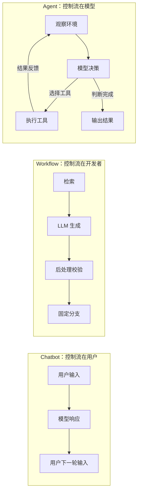
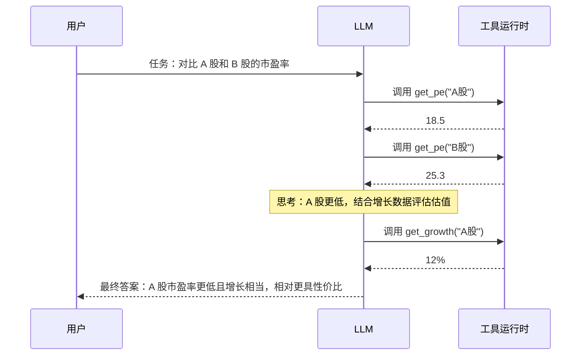

# AI 智能体全景：从 Chatbot 到自主 Agent 的跃迁

过去两年，"Agent"这个词被用得越来越泛滥。一个加了 function calling 的聊天机器人叫 Agent，一条固定流程的自动化流水线也叫 Agent。这种概念的模糊让很多团队在做技术选型时走了弯路：要么把一个本该用确定性代码解决的问题硬塞给了模型，要么把一个真正需要模型自主决策的问题用 if-else 写死了。

这篇文章想做的事很具体：把"Agent 到底是什么"从控制流归属的角度讲清楚，拆解它的认知架构，对比主流框架，并总结实践中最常见的失败模式。读完之后，你应该能够回答一个问题——**我这个场景，到底需不需要 Agent**。

## 一、Chatbot、Workflow 与 Agent：控制流在哪里

区分这三者的关键不是"有没有用 LLM"，而是**运行时的控制流归谁所有**。

**Chatbot**：控制流在用户手里。每一轮对话由用户发起，模型做一次"输入到输出"的映射，没有自主的执行计划。即使接了工具，工具调用也是单轮的、由用户意图直接触发的。

**Workflow**：控制流在开发者手里。开发者预先写好了代码路径——先调用检索，再调用模型，再做校验，任何一步失败走哪条分支都是编译期确定的。LLM 在这里只是流水线上的一个"更聪明的节点"。RAG 系统的典型形态就是 Workflow：检索、拼接、生成、后处理，每一步都是确定的。

**Agent**：控制流在模型手里。给定一个目标，模型自己决定下一步做什么、调用什么工具、什么时候结束。开发者不再编写执行路径，而是编写"能力边界"（工具集）和"行为约束"（system prompt、护栏）。LLM 从节点变成了**调度器本身**。

这个视角来自 Anthropic 的《Building Effective Agents》，也是目前业界最有共识的定义方式。它带来一个重要的推论：**Agent 的可靠性本质上低于 Workflow**。因为控制流从确定性的代码转移到了概率性的模型，每一步决策都有出错的可能。这不是模型的 bug，而是范式的固有属性。Agent 换来的是处理开放性问题的能力，代价是可预测性。

## 二、认知架构四大件：Planning、Memory、Tool Use、Reflection

如果把 Agent 拆开看，一个可用的 Agent 通常由四个核心组件构成。这四个组件的组合方式决定了 Agent 的能力上限。

### 2.1 规划（Planning）

规划解决的是"如何把一个复杂目标分解为可执行步骤"的问题。常见形态有三类：

- **无显式规划的 ReAct**：每一步根据当前观察即兴决定下一步。适合目标本身比较模糊、需要边探索边明确方向的场景。
- **先规划后执行（Plan-and-Execute）**：先让模型产出完整的任务清单，再逐步执行。适合结构清晰的多步任务，例如"调研某个主题并写报告"。显式计划还有一个好处：可以把计划持久化，执行失败时可以从某个步骤恢复，而不必从头再来。
- **分层规划**：一个规划器负责拆解子目标，多个执行器负责完成具体任务。这是多智能体系统的基础，本文不展开，后续文章会专门讨论。

工程上的关键认知是：**LLM 的规划能力远弱于它的生成能力**。让模型直接规划 20 步以上的任务，计划的后面部分往往自相矛盾。实践中有效任务规划长度通常在 3-7 步，超过这个长度就需要外部的任务管理机制（任务清单、看板、状态机）来兜底，而不是指望模型自己记住全部计划。

### 2.2 记忆（Memory）

记忆不是一个功能，而是一个谱系，按时间尺度和实现方式可以分为几层：

- **短期记忆**：就是上下文窗口本身。当前对话、已执行的步骤、工具返回结果，全部堆在 context 里。它的容量上限就是模型的最大 token 数。
- **会话级持久化**：跨轮次的对话历史。最简单的实现是把历史消息重放给模型，但历史一长，token 成本和注意力稀释都会成为问题。常见优化是滑动窗口加摘要：保留最近 N 轮原文，更早的内容压缩成摘要。
- **长期记忆**：跨会话的用户偏好、事实知识。通常落地为向量数据库（语义检索）或结构化存储（键值对），在每轮开始时检索相关片段注入上下文。

这里有一个容易被忽略的坑：**记忆写入比记忆读取更难**。读是检索问题，有成熟的向量检索方案；写则需要模型自己判断"什么值得记"。让模型无条件记下所有对话内容，长期记忆会迅速被噪声淹没，检索质量反而下降。实践中通常用独立的"反思"步骤在会话结束时提炼记忆，而不是实时记录。

### 2.3 工具使用（Tool Use）

工具是 Agent 与真实世界交互的唯一通道。现代 LLM 的 function calling 机制已经把"如何调用工具"标准化了：模型输出结构化的工具调用请求（函数名 + JSON 参数），运行时执行后把结果回填。

工具设计的质量直接决定 Agent 的成功率，几条实战经验：

- **工具的描述文案比工具本身更重要**。模型是通过工具的 name、description、参数 schema 来理解工具的。描述含糊的工具，模型会以出人意料的方式错误调用。
- **工具数量存在甜点区**。工具太多（超过 20 个左右），模型的工具选择准确率会明显下降。可以按场景动态注入工具子集，或者做两层工具：先选类别再选具体工具。
- **错误信息要能被模型读懂**。工具报错时返回的不是"Error 500"，而是"参数 date 格式应为 YYYY-MM-DD，你传入了 '明天'"——后者能让模型自我修正，前者只会让模型盲目重试。

### 2.4 反思（Reflection）

反思是让 Agent 对自己的输出进行自我评估和修正的机制。最简单的形态是"生成-批判-修正"循环：第一次生成结果后，用同一个模型（或更强的模型）扮演评审者，检查结果是否满足要求，不满足则带着批评意见重新生成。

Reflection 的价值在于把"一次生成"的概率分布问题转化为"多次迭代收敛"问题——单次输出的失败率是 p，带反思的 k 次迭代失败率接近 p^k（假设各次独立）。但代价也明显：每次反思意味着额外的模型调用，延迟和成本成倍增长，而且**自我反思存在盲区**——模型犯的某些系统性错误，它自己批判不出来。更可靠的做法是引入外部信号作为反思的依据：单元测试的运行结果、代码的静态检查输出、HTTP 请求的真实响应。这些来自执行环境的真实反馈，比模型的自省有效得多。

## 三、ReAct：把推理和行动交织起来

ReAct（Reasoning + Acting，Yao et al., 2022）是目前绝大多数 Agent 框架的底层范式。它的核心思想很简洁：**不要让模型先想完再动，也不要先动完再想，而是让"思考"和"行动"交替进行**。

在 function calling 普及之前，ReAct 是通过纯 prompt 工程实现的：在提示词里给模型几个示范，约定用固定的文本格式输出 `Thought / Action / Observation` 三段式，然后用解析器把 Action 抠出来执行。现在有了原生 function calling，结构更自然：

1. 模型收到任务和可用工具描述；
2. 模型可以选择输出一次工具调用（Act），工具调用前的文本内容就是它的思考（Reason）；
3. 运行时执行工具，把结果作为 tool message 回填（Observation）；
4. 循环，直到模型不再请求工具、直接给出最终回答。

这个交织设计为什么有效？关键在于**每一步行动的依据是最新的观察，而不是过时的想象**。传统 chain-of-thought 是"一次性把推理做完"，推理过程中对世界的假设如果错了，后面全错。ReAct 让推理建立在真实反馈之上：搜索结果不对，下一步就换个关键词；计算结果异常，下一步就检查输入。这种"边走边修正"的能力是 Agent 区别于单次生成的根本。

ReAct 并非没有代价。每一步工具调用都是一次完整的模型往返，十步任务就是十次推理，延迟和 token 成本线性增长。此外，中间的思考内容会占据大量上下文，长任务的上下文管理（见后文的"上下文腐烂"）必须做好。

## 四、Agent 还是 Workflow：Anthropic 的选型原则

Anthropic 在《Building Effective Agents》中给出的核心建议可以浓缩为一句话：**能用 workflow 解决的问题，就不要上 agent**。这句话值得展开成三条判断标准：

**第一，任务的执行路径是否可预先枚举。** 如果你可以把任务的每一步都写清楚（即使步骤内部用模型生成内容），那就是 Workflow。例如"从工单提取字段，查知识库，按模板生成回复"——路径完全确定，做成 Workflow 意味着每一步都可以单独测试、单独监控、失败单独重试。上 Agent 等于把确定性问题变成了概率问题，纯粹是负收益。

**第二，目标是否允许"过程不可知"。** Agent 的价值在于处理执行路径无法预先定义的开放任务："调研这个库为什么构建变慢并给出修复方案"——你没法枚举路径，因为你不知道慢的原因。这类任务只能交给 Agent，或者交给带着 Agent 探索的工程师。

**第三，失败的成本是否可接受。** Agent 会犯错，而且错误会级联。写一份报告草稿，Agent 犯错可以接受，人工审核兜底；执行生产环境的数据库变更，一次错误调用可能是事故。低容错场景要么用 Workflow 严格约束，要么在 Agent 外面包裹审批环节（human-in-the-loop）。

还有一个中间形态常被忽略：**把 Agent 嵌进 Workflow 里**。整条流水线是确定的，但其中某一步（比如"分析日志找出异常模式"）是开放性的，就单独在那一节点放一个受限的 Agent，工具集收窄、步数上限设死、输出格式校验。这是目前生产环境中最常见的落地形态——**系统整体可控，局部自主**。

## 五、主流框架速览与选型建议

### LangGraph

LangGraph 把 Agent 建模为**显式的状态图**：节点是处理步骤（模型调用、工具执行、代码逻辑），边是控制转移，支持条件分支和循环。它的哲学是"把控制流图写出来"，即使这个图里大部分边由模型决策驱动。优点是状态管理严谨、支持持久化检查点（任何一步中断可恢复）、可视化调试友好；缺点是抽象层次较多，简单任务写起来偏重。适合生产级的复杂 Agent 系统，尤其是需要人工审批节点、断点恢复的场景。

### OpenAI Agents SDK

OpenAI 的 Agents SDK 走极简路线，核心概念只有三个：Agent（配置了指令和工具的模型包装）、Handoff（智能体之间的任务移交）、Guardrail（输入输出校验）。它的多智能体协作就是通过 handoff 实现——一个 Agent 判断"这活该别人干"，直接把控制权连同上下文移交出去。优点是上手极快、代码可读性好；缺点是状态管理和复杂控制流的表达能力弱于 LangGraph。适合工具调用为主、协作关系简单直接的场景。

### AutoGen

微软的 AutoGen 的核心抽象是**对话式多智能体**：Agent 之间通过互发消息协作，支持"群聊"模式（GroupChat）由一个管理 Agent 协调发言顺序。它的哲学是把多智能体协作看作多方对话，而不是图执行。学术圈用它做多智能体研究的比较多。优点是协作模式灵活、研究性强；缺点是消息驱动的执行流在生产中较难调试和约束。

### CrewAI

CrewAI 采用**角色分工**的隐喻：定义一组带角色（role）、目标（goal）、背景故事（backstory）的 Agent，组成一个 Crew，按顺序或由管理器协调完成流程化任务。优点是概念直观，"组建一个团队"的心智模型对业务开发者友好；缺点是灵活性有限，复杂控制流表达不如 LangGraph。

选型建议总结为一句话：**先想清楚你需不需要框架**。很多团队的问题不是选错了框架，而是根本不需要框架——一个 200 行的 ReAct 循环（下一篇文章会手写一个）加一个任务清单文件，比引入全家桶框架更可控。框架的真正价值在于：状态持久化、可视化、多智能体通信这些基础设施。如果你的 Agent 就是单线程工具调用循环，直接用 SDK 原生能力就够了。

## 六、典型失败模式与工程缓解

### 6.1 误差累积

Agent 的每一步都建立在之前步骤的结果之上。如果每步决策有 5% 的错误率，20 步任务的整体成功率只有约 0.95^20 ≈ 36%。这就是 Agent 任务"短的成功、长的必挂"的数学根源。

缓解手段：把长任务切成阶段，每个阶段结束做一次校验（输出格式、关键约束），校验失败就在阶段内重试而不是带着错误继续；对关键步骤引入外部验证（跑测试、执行代码、调 API 确认），用真实世界反馈替代模型自评。

### 6.2 无限循环

最经典的形态：工具持续报错，模型持续用同样的参数重试；或者两个工具互相触发，陷入 A→B→A 的环。模型没有真正的记忆能力去识别"我刚才已经试过了"，尤其是当上下文很长、相似内容被注意力稀释之后。

缓解手段：硬性最大步数上限（这个必须设，没有例外）；重复调用检测——记录 (工具名, 参数) 的哈希，同一调用出现两次就注入一条系统消息强制模型换策略；在 system prompt 里明确写"连续失败 N 次后应当停下并报告"，同时让停止后的输出结构化，便于上层决定是重试、降级还是转人工。

### 6.3 上下文腐烂

长任务中上下文逐渐堆积：早期的失败尝试、超长的工具输出、过时的中间结论。问题在于这些内容不会消失，模型会持续被它们干扰——被三天前的错误结论带偏，注意力被一万 token 的日志输出占据。上下文不是越长越好，**腐烂的上下文比没有上下文更糟**。

缓解手段：工具结果回填前做裁剪（只保留关键字段，全文落盘到文件需要时再读）；阶段性上下文压缩——执行若干步后把历史折叠成摘要；旧的工具结果主动替换成占位符。核心原则是：上下文里只放"当前决策需要的最小信息集"。

## 七、什么时候才真的需要 Agent：一份判断清单

最后把全文收敛成一份可操作的清单。满足以下全部或大部分条件时，Agent 才是正确的工具：

1. **执行路径无法预先枚举**——你写不出决定性的流程图，因为路径取决于运行时才能发现的信息；
2. **目标可验证**——存在客观的完成判据（测试通过、字段正确、问题被回答），否则 Agent 失败了你都不知道；
3. **失败成本可承受**——或者有护栏兜底（沙箱执行、只读权限、人工审批门）；
4. **任务具有多步性**——单步就能完成的任务不值得引入循环开销；
5. **模型能力足以覆盖核心步骤**——如果核心步骤（如复杂计算）模型本身不可靠，先为该步骤提供专用工具，再考虑 Agent 化。

反过来，出现以下任何一条，请退回 Workflow：路径可以写死；输出必须严格可预测；单次调用的成本预算紧张；错误会直接产生资损或安全事故。

Agent 不是 Chatbot 的升级版，而是一种以可控性换取开放性的架构选择。真正成熟的工程实践，是知道在哪条流水线的哪个节点，值得把控制流交给模型——以及在哪里，必须牢牢握在自己手里。
