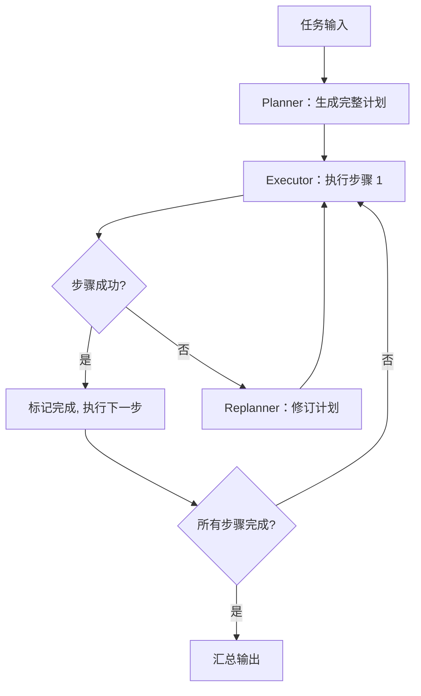

# ReAct、Plan-and-Execute 与 Agent 决策循环：原理与手写实现

用框架搭 Agent 很容易，但出了 bug 不知道往哪查。问题通常出在对决策循环本身的理解不够：循环什么时候终止、中间态怎么管理、模型为什么突然开始复读同一个工具调用。这篇文章把三种经典的 Agent 决策循环讲透，然后抛开源码依赖，用 openai SDK 手写一个完整可运行的 ReAct Agent——写完之后你会发现，框架里那层神秘的"引擎"，核心逻辑不过百余行。

## 一、ReAct：推理与行动的交织

### 1.1 论文思想

ReAct（Reasoning + Acting）出自 Yao et al. 2022 年的论文《ReAct: Synergizing Reasoning and Acting in Language Models》。在此之前，两条主流路线各有明显缺陷：

- **纯推理路线（chain-of-thought）**：模型一次性生成完整推理链再行动。推理过程全部基于假设，中途某个假设错了，后续推理在错误地基上继续盖楼，且没有机会修正。
- **纯行动路线**：模型直接生成动作序列（类似模仿学习），没有显式推理，缺乏规划性，泛化能力差，遇到没见过的任务就乱来。

ReAct 的洞察是：**推理和行动不是两个阶段，而是一个循环的两个相位**。思考决定下一步行动，行动产生观察，观察修正下一步思考。论文里的轨迹格式是纯文本的：

```
Thought 1: 用户问的是作者出生地所属的国家，我需要先查作者。
Action 1: Search[Arthur Schopenhauer]
Observation 1: Arthur Schopenhauer was a German philosopher (1788–1860)...
Thought 2: 观察说是德国哲学家，出生地在但泽（当时属普鲁士），答案应是德国。
Action 2: Finish[德国]
```

每一步 Thought 显式地记录了模型当前的推理状态，Action 是对环境的操作，Observation 是环境返回的真实反馈。三者交替，直到 Action 是"终止"动作。

### 1.2 从文本解析到 function calling

原始 ReAct 靠 prompt 约定格式 + 正则解析，脆弱且容易被模型的"自由发挥"打破。2023 年年中 OpenAI 推出 function calling 后，Action 有了原生结构化表达：模型通过 API 的 `tool_calls` 字段输出工具调用（函数名 + JSON 参数），运行时执行后以 `role: "tool"` 消息回填 Observation。Thought 则体现在工具调用之前的文本内容（`message.content`）中，或者干脆隐式化——模型不写思考直接调用工具，推理压缩进了决策本身。

这个演变的工程意义很大：**Action 从"需要解析的文本"变成"协议保证的结构化数据"**，解析失败这一整类 bug 基本消失了。但理解文本形态的 ReAct 仍然有价值，因为大量框架的 prompt 工程、以及模型在 few-shot 场景下的行为习惯，仍然带着那个时代的痕迹。

## 二、三种决策循环：ReAct、Plan-and-Execute、Reflexion

### 2.1 ReAct：即兴决策循环

每一步基于当前完整上下文即时决定下一步。没有显式的全局计划，模型的"计划"隐含在每一步的 Thought 里。

适用场景：目标模糊、需要边探索边调整的任务（"这个报错是怎么回事"），步数较少（5 步以内）、探索分支不深的任务。

代价：步数一长，早期决策的质量会下降——模型没有任何全局规划，只靠局部贪心，容易走进死胡同再绕出来，浪费步数和 token。

### 2.2 Plan-and-Execute：先规划后执行

两阶段结构：Planner 一次性产出任务清单，Executor 逐步执行（执行器本身往往就是一个小的 ReAct 循环）。典型实现如 LangChain 的 Plan-and-Execute Agent、BabyAGI。



关键增强是 **Replan**：执行中发现计划与现实的偏差（某工具不可用、某步骤输出出乎意料），重新规划剩余步骤。

适用场景：结构清晰的长任务（"调研 X 并产出报告"）、需要任务状态持久化的场景（计划可以落盘，中断后可恢复）、需要人工审核计划的场景（计划先给人过目再执行）。

代价：规划的准确性前置——初始计划错了，后面全在错误轨道上；计划外的情况需要触发 Replan，增加复杂度。

### 2.3 Reflexion：带自我反思的迭代循环

Reflexion（Shinn et al., 2023）把循环的粒度从"步"提升到"轮"：完整执行一次任务 → 失败后生成语言化的反思（哪里错了、下次怎么改）→ 把反思写入记忆，带着它重新执行。反思本质上是**把失败的执行轨迹蒸馏成可复用的经验教训**。

适用场景：存在明确外部验证信号的任务（代码能否通过测试、答案是否正确），且单次执行不贵、可以承受多轮重试。

代价：每轮重试都是全量成本，不适合昂贵任务；没有验证信号时反思质量差——模型对着一个没人验证的结果自我反思，往往反思不出真问题。

### 2.4 三者对比与组合

| 维度 | ReAct | Plan-and-Execute | Reflexion |
|------|-------|------------------|-----------|
| 决策方式 | 每步即兴 | 全局计划 + 逐步执行 | 多轮执行 + 反思迭代 |
| 全局视野 | 弱（局部贪心） | 强（显式计划） | 中（跨轮记忆） |
| 额外成本 | 低 | 中（规划 + Replan） | 高（整轮重试） |
| 典型任务 | 探索型短任务 | 结构化长任务 | 可验证的可重试任务 |

三者不是互斥的，生产系统常见组合是：外层 Reflexion（验证失败重试），中层 Plan-and-Execute（先出计划再执行），内层 ReAct（单步需要工具时）。层级越深，工程复杂度越高，能不叠加就不叠加。

## 三、手写一个 ReAct Agent

下面用 openai SDK + function calling 手写一个完整可运行的 ReAct Agent，带两个工具：模拟搜索和四则运算计算器。整个实现约 120 行，包含终止条件、最大步数保护、工具结果截断、重复调用检测等工程细节。

```python
"""
一个手写的 ReAct Agent：openai SDK + function calling
依赖: pip install openai
"""
import json
import math
import os
from openai import OpenAI

MODEL = "gpt-4o-mini"
MAX_STEPS = 10              # 最大步数保护：硬性上限，没有例外
MAX_TOOL_RESULT_CHARS = 3000  # 工具结果截断阈值
MAX_REPEATED_CALLS = 2      # 同一工具调用允许重复的最大次数

# ---------- 工具实现 ----------

def tool_search(query: str) -> str:
    """模拟搜索工具：真实场景替换为搜索 API"""
    fake_db = {
        "阿姆斯特朗": "尼尔·阿姆斯特朗，1930年8月5日出生，1969年7月21日成为第一个踏上月球的人。",
        "月球": "月球是地球唯一的天然卫星，平均直径约3474.8公里，距地球平均约38.44万公里。",
    }
    for keyword, info in fake_db.items():
        if keyword in query:
            return info
    return f"未找到与 '{query}' 相关的信息。"

def tool_calculator(expression: str) -> str:
    """四则运算计算器：用受限求值保证安全"""
    allowed = set("0123456789+-*/(). %")
    if not set(expression) <= allowed:
        return "错误：表达式包含非法字符。"
    try:
        # 受限的 eval：字符白名单校验后仅允许数字运算
        result = eval(expression, {"__builtins__": {}}, {"sqrt": math.sqrt})
        return str(result)
    except Exception as e:
        # 错误信息必须能让模型读懂并自我修正
        return f"计算错误：{type(e).__name__}，请检查表达式格式。"

TOOLS_IMPL = {"search": tool_search, "calculator": tool_calculator}

# ---------- 工具 schema（发给模型的接口描述） ----------

TOOLS_SCHEMA = [
    {
        "type": "function",
        "function": {
            "name": "search",
            "description": "搜索事实信息。当需要查询人物、事件、数字等事实时使用。",
            "parameters": {
                "type": "object",
                "properties": {
                    "query": {"type": "string", "description": "搜索关键词，用简洁的中文或英文短语"}
                },
                "required": ["query"]
            }
        }
    },
    {
        "type": "function",
        "function": {
            "name": "calculator",
            "description": "四则运算计算器。表达式只允许数字和 +-*/(). 符号。",
            "parameters": {
                "type": "object",
                "properties": {
                    "expression": {"type": "string", "description": "数学表达式，如 (1+2)*3"}
                },
                "required": ["expression"]
            }
        }
    }
]

SYSTEM_PROMPT = """你是一个严谨的助手，通过调用工具来回答需要外部信息或计算的问题。
规则：
1. 需要事实信息时调用 search，需要计算时调用 calculator，绝不凭记忆编造数字。
2. 拿到足够的信息后，直接给出最终回答，不再调用工具。
3. 同一个调用失败两次后，换一种思路，不要原样重试。
4. 最终回答要直接、简洁，注明信息来源。"""

# ---------- 工具结果截断 ----------

def truncate(text: str, limit: int = MAX_TOOL_RESULT_CHARS) -> str:
    """截断过长的工具结果，防止上下文爆炸"""
    if len(text) <= limit:
        return text
    return text[:limit] + f"\n...[结果已截断，原始长度 {len(text)} 字符]"

# ---------- 核心循环 ----------

def run_agent(question: str, client: OpenAI) -> str:
    messages = [
        {"role": "system", "content": SYSTEM_PROMPT},
        {"role": "user", "content": question},
    ]
    call_history = {}   # (name, args) -> 次数，用于重复调用检测

    for step in range(MAX_STEPS):
        response = client.chat.completions.create(
            model=MODEL,
            messages=messages,
            tools=TOOLS_SCHEMA,
        )
        msg = response.choices[0].message

        # 终止条件：模型不再请求工具，返回最终答案
        if not msg.tool_calls:
            return msg.content or "（模型返回空回答）"

        messages.append(msg)  # 必须把 assistant 消息原样入列，含 tool_calls

        for tc in msg.tool_calls:
            name = tc.function.name
            try:
                args = json.loads(tc.function.arguments)
            except json.JSONDecodeError:
                # JSON 解析失败：把解析错误作为观察回填，让模型自行修正参数
                observation = f"错误：工具参数不是合法 JSON：{tc.function.arguments[:200]}"
                messages.append({"role": "tool", "tool_call_id": tc.id,
                                 "content": observation})
                continue

            print(f"[step {step + 1}] {name}({args})")
            key = (name, json.dumps(args, sort_keys=True))
            call_history[key] = call_history.get(key, 0) + 1
            if call_history[key] > MAX_REPEATED_CALLS:
                # 重复调用检测：注入干预消息，强制换策略
                observation = (
                    f"错误：这个调用已经重复了 {call_history[key]} 次且结果相同。"
                    "请停止原样重试，换一种方法，或直接基于已有信息作答。"
                )
            elif name in TOOLS_IMPL:
                try:
                    observation = truncate(str(TOOLS_IMPL[name](**args)))
                except TypeError as e:
                    observation = f"错误：参数不匹配（{e}），请对照工具定义检查参数名和类型。"
            else:
                observation = f"错误：未注册的工具 '{name}'。"

            messages.append({"role": "tool", "tool_call_id": tc.id,
                             "content": observation})

    # 最大步数保护触发：强制收尾，不让循环失控
    return "已达最大步数上限，任务未完成。已获取的中间信息不足以给出可靠答案。"

if __name__ == "__main__":
    client = OpenAI(api_key=os.environ["OPENAI_API_KEY"])
    answer = run_agent(
        "阿姆斯特朗出生那年是闰年吗？用计算器验证一下 1930 能否被 4 整除。",
        client,
    )
    print("\n最终回答：", answer)
```

### 3.1 工程细节逐条拆解

**终止条件**：`if not msg.tool_calls` 是唯一的自然终止信号——模型认为信息足够，直接回答。注意这依赖 system prompt 里的明确指令（"拿到足够信息后直接回答"），否则模型可能陷入"再查一次确认下"的无限确认循环。

**最大步数保护**：`MAX_STEPS` 是硬性熔断。触发后**不要返回异常**，而是返回一条结构化的失败说明——调用方需要区分"任务完成"和"任务失败"，两者的下游处理完全不同。

**工具结果截断**：搜索类工具动辄返回几千 token，几个来回就把上下文撑爆。截断阈值按模型上下文的 1/10 到 1/5 设定比较稳妥，截断信息本身也要写进回填内容，让模型知道"只看到了一部分"。

**重复调用检测**：`(工具名, 参数)` 作为键计数，超过阈值后不执行工具，而是把"你在原地打转"作为观察回填。这比单纯拒绝执行有效得多——模型需要的是被告知问题所在，而不是沉默的失败。

**错误回填即观察**：所有工具错误（JSON 解析失败、参数不匹配、未注册工具）都以 `role: "tool"` 消息回填，而不是抛异常。这是 ReAct 的精髓：**错误也是环境的观察**，模型读到结构化的错误描述后自我修正的比例相当高，尤其是参数格式类错误。

### 3.2 两个容易被忽略的正确性细节

其一，`messages.append(msg)` 必须把含 `tool_calls` 的 assistant 消息**原样**入列，且紧跟的 tool 消息按 `tool_call_id` 一一对应。OpenAI API 会严格校验这个配对关系，漏掉或顺序错乱直接报 400。并行工具调用（一次响应里多个 `tool_calls`）时，每一条都要有对应的 tool 回填。

其二，计算器里的字符白名单校验不是过度防御。模型偶发会生成 `os.system(...)` 之类的表达式（尤其当上下文里出现过类似内容时），直接 `eval` 等于把任意代码执行暴露给一个概率性系统。工具层的安全校验，永远是 Agent 工程的第一道防线。

## 四、循环中的常见 bug 与修复

### 4.1 工具 JSON 解析失败重试

现象：模型的 `arguments` 字段偶发不是合法 JSON（截断、混入注释、用了单引号）。低级修法是运行时自己尝试修复（替换单引号、补全括号）——效果差且掩盖问题。正确修法是把解析错误作为观察回填（如上面代码所示），同时注意一个细节：**解析失败的那条消息结构上仍要回填**，否则下一次请求会因 tool_call 缺少响应而被 API 拒绝。

如果解析失败率异常高（超过 1%），先检查是不是温度设置过高、或者模型版本太老不支持严格模式。OpenAI 较新的模型支持 `strict: true` 的 schema 校验，可以从协议层保证参数合法。

### 4.2 思维链泄露

现象：在面向用户的场景中，模型的内部思考（对工具结果的吐槽、中间推理、"等等，这不对"）被直接返回给了用户。这是把 `msg.content` 在无 tool_calls 时直接当最终答案导致的——模型的"过渡性自言自语"和"面向用户的回答"在 API 层面是同一字段。

修复：在 system prompt 中区分角色（"最终回答应当面向用户，不要包含工具调用的内部过程"）；更可靠的是在输出层做格式约束——要求最终回答符合某种结构（JSON schema 或固定格式），或在返回前做一次"清洗调用"：把中间轨迹交给模型提炼成用户友好的答案。泄露不只难看，还可能暴露系统内部信息（工具名、数据片段），面向外部用户的系统必须在出口处处理。

### 4.3 观察与消息顺序错乱

现象：`Error: tool_call_id not found` 或上下文错乱导致模型困惑。根因几乎都是消息序列被手工拼接时违反了配对规则：assistant(tool_calls) 之后必须紧跟对应数量的 tool 消息。多工具并行调用时最容易错。修复没有捷径——永远通过 append 完整的 `msg` 对象、按 tool_calls 顺序逐条回填，不要自己组装 assistant 消息。

### 4.4 "确认强迫症"循环

现象：任务已完成，模型仍反复调用工具"再确认一下"。根因是 system prompt 没有给出清晰的完成判据。修复：把"什么时候算完成"写进指令（"找到日期信息即视为信息足够"），并在观察到重复的已完成信息时主动注入提示（"所需信息已在上下文中，请直接回答"）。

## 五、结语

把这个手写循环放回框架视角：LangGraph 的 Agent 节点、OpenAI Agents SDK 的 run loop，本质上都是这段代码的工业化版本——加了状态持久化、流式输出、重试策略、多智能体路由。理解了这个 120 行的内核，框架的文档就从"需要背诵的 API"变成了"可以推断的设计"。

下一步的实践建议：把 `TOOLS_IMPL` 里的模拟搜索换成真实搜索 API，把 `call_history` 的检测阈值调成动态的（前几步宽松、接近步数上限时收紧），然后故意造几个坏工具（返回超长文本、随机报错）观察循环的容错表现——手写循环最大的价值，就是你可以随意拆解它。
