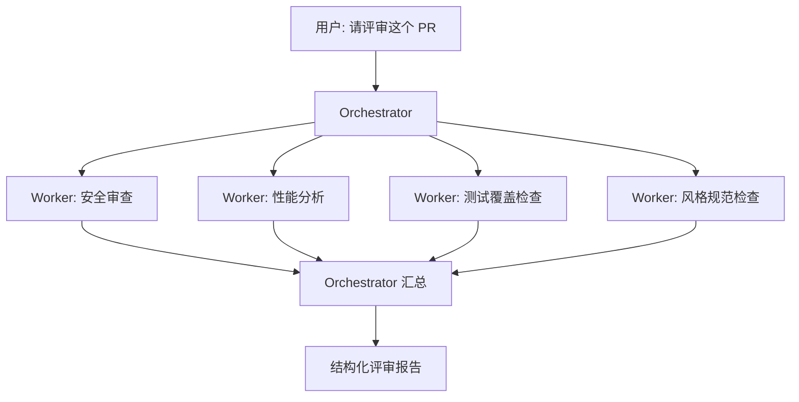
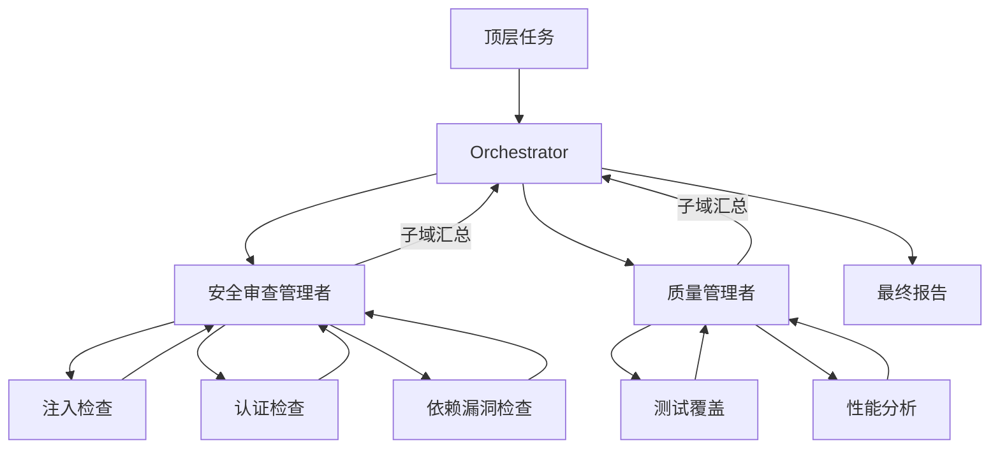
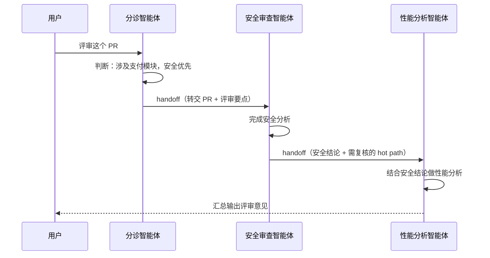
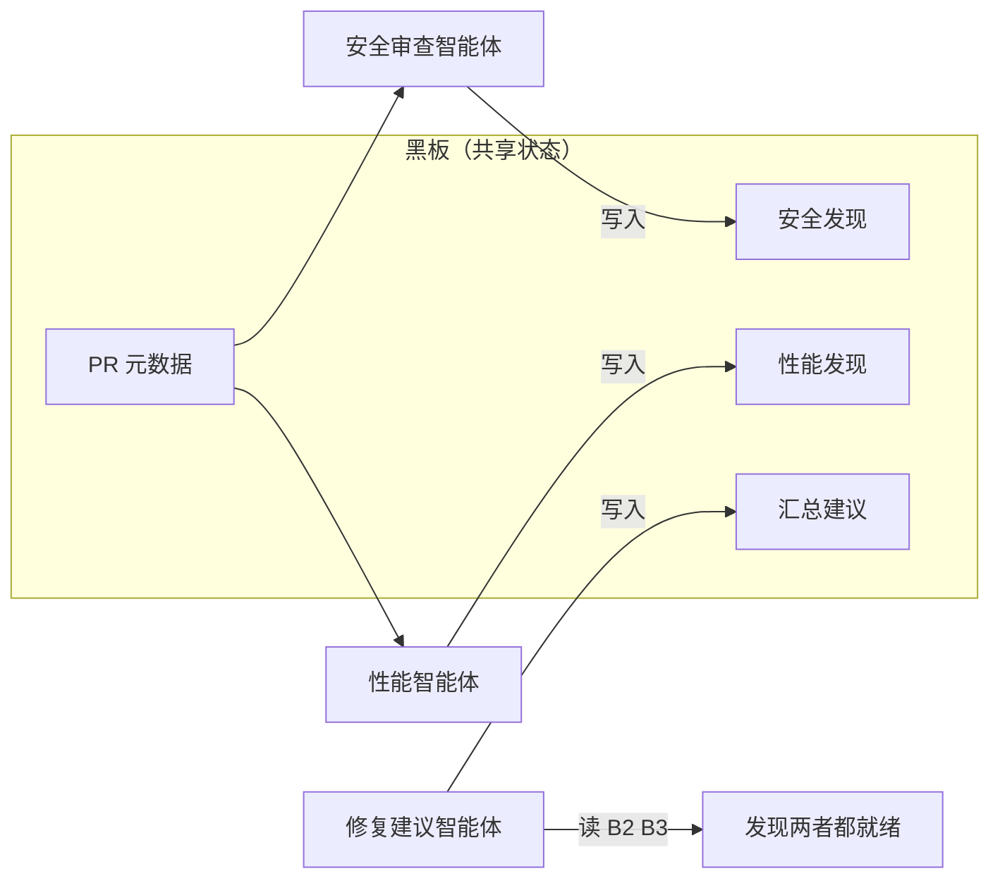

# 多智能体系统设计模式：编排、通信与失败恢复

上一篇文章手写的 ReAct 循环，就是一个完整的最小智能体。但在真实系统里，一个智能体经常不够用：上下文塞不下所有工具和领域知识，串行执行拖慢端到端延迟，一个"全能提示词"里混杂的安全审查逻辑和代码生成逻辑互相干扰。这时候就要考虑把系统拆成多个智能体。

但拆分是有代价的——多智能体系统引入了新的复杂度维度：谁负责调度、智能体之间怎么说话、一个智能体挂了怎么办、token 成本为什么翻了五倍。这篇文章以一个贯穿案例——**代码评审多智能体系统**——来回答这四个问题。

## 一、什么时候需要多智能体

先说结论：大多数场景不需要多智能体。判断拆分是否正当，只有三条硬理由：

**理由一：上下文隔离。** 这是最容易被低估也最本质的理由。假设代码评审需要同时检查安全性、性能、风格、测试覆盖——四个领域的检查清单、参考规范、历史案例加起来轻松超过 50K token。塞进一个智能体的上下文，意味着每一项检查都在被无关信息稀释注意力。拆成四个子智能体后，每个只携带自己领域的最小上下文。**多智能体的收益本质上是上下文的隔离，而不是"角色"的多少**。如果你只是想给任务换个措辞、换个角色扮演设定，那不是多智能体，那是 prompt 变体。

**理由二：并行执行。** 四个独立维度的检查天然可以并行，端到端延迟从四次串行调用降为最慢一路的耗时。并行的前提是子任务之间没有数据依赖，且结果可以事后汇聚。

**理由三：专业分工。** 这里的"专业"不是角色扮演，而是**工具与权限的隔离**。评审中的"修复建议生成"智能体需要代码写权限（修改文件、跑测试），而"安全审查"智能体应该只有读权限——权限边界即安全边界。此外，不同任务配不同的模型（重推理的用强模型、格式化的用便宜模型）也是拆分的正当理由之一。

反过来说，如果你的场景只是"任务太复杂，一步做不完"，正确答案通常是更好的任务分解和规划（Plan-and-Execute），而不是多智能体。**单智能体方案穷尽之前，不要上多智能体。**

## 二、四种经典编排模式

### 2.1 Orchestrator-Workers：调度器加工人

一个编排智能体接收任务、拆解、分发给多个 worker 智能体、收集结果、汇总输出。worker 之间互不通信。这是最常用、最可控的模式。



优点：控制流清晰，全部决策路径可追溯；worker 无状态，崩溃即重试；易于做权限隔离。缺点：Orchestrator 是单点和瓶颈——它自身的决策质量决定了整个系统的上限，且它需要理解所有子任务的接口。

适用：子任务边界清晰、拆解规则可描述的任务。代码评审正是典型：评审维度是固定的，Orchestrator 的拆解工作近乎模板化。

### 2.2 Hierarchical：分层管理

Orchestrator-Workers 的递归版本：管理者下面还有管理者，形成管理树。顶层 Orchestrator 拆出"安全审查"这个大项，安全审查管理者又拆出"注入检查""认证检查""依赖漏洞检查"三个子 worker。



优点：每一层的复杂度都被下级吸收，顶层不必理解全部细节，适合任务树很深的场景（如大型代码库的全库审计）。缺点：层数增加意味着信息传递的层级增加，每层汇总都是一次信息压缩，最底层的重要发现可能被中层过滤掉；调试困难，一个最终结论的错误可能源于树中任何一层。

适用：任务天然具有层级结构（目录树、组织结构、系统模块）的场景。**层数控制在两到三层**，超过三层通常说明任务分解本身有问题。

### 2.3 Peer-to-Peer：对等移交（Handoff）

没有中心调度器，智能体之间平等对话。一个智能体处理到某个阶段，判断"该交给别人了"，就把控制权和上下文整体移交（handoff）给另一个智能体。OpenAI Agents SDK 的 Handoff、LangGraph 的多智能体交换都是这个模式。



优点：最接近人类专家协作的模式，灵活，支持流水线式和轮转对话式等多种形态；没有单点调度瓶颈。缺点：**控制流最不可控**——移交决策由模型做出，可能互相踢皮球（A 移交给 B，B 又移回给 A，乒乓循环）；全局状态管理困难，上下文在移交链上不断膨胀。

适用：移交条件可以用自然语言清晰描述、且移交链较短（两到三跳）的场景。实施要点：移交必须带移交理由和上下文打包，且设置全局移交步数上限，超限强制汇总结束。

### 2.4 Blackboard：黑板模式

借鉴经典 AI 的黑板架构：一个共享的工作区（黑板），所有智能体都能读取黑板状态、在满足自身触发条件时写入贡献。没有显式的调度器，协调是隐式的——谁的数据齐了谁来接活。



优点：松耦合，智能体增删不影响他人；天然适合"贡献依赖关系复杂、触发时机不定"的场景。缺点：需要外部机制管理状态一致性和执行顺序（谁先跑、冲突怎么办），通常要靠一个简单的外层循环驱动；隐式协调难以推理，全量执行顺序必须显式规划。

适用：各智能体的触发条件是"数据就绪"而非"被指派"的场景。工程实现上，黑板的读写冲突必须用乐观锁或版本号管理——两个智能体同时写同一个键的结果会互相覆盖。

### 2.5 模式选择

一个实用的决策规则：**默认 Orchestrator-Workers**。它最可控、最可观测、最好调试。只有当任务天然呈层级结构时升级为 Hierarchical；当移交条件是"语义判断"而非"规则判断"且链路短时用 Handoff；当智能体贡献的依赖关系复杂时才考虑 Blackboard。混合形态也常见：评审系统的整体骨架用 Orchestrator-Workers，其中"修复建议"环节用 Handoff 交给一个带写权限的修复智能体。

## 三、上下文隔离与"上下文税"

子智能体上下文隔离的原理值得讲透。Orchestrator 派发给 worker 的不应该是"完整对话历史"，而是一个**任务包**：目标描述、必要输入（相关代码片段）、输出格式要求。worker 从零开始构建自己的上下文，运行自己的工具循环，最后把结果压缩后交回。

这个设计的收益很直接：worker 的上下文里没有 Orchestrator 的决策历史、没有其他 worker 的信息，注意力全部集中在自己的子任务上。模型注意力是有限资源，上下文越干净，单步决策质量越高。

但它制造了一个新的成本项，我称之为**上下文税**：Orchestrator 打包任务要花 token（把相关代码片段、约束条件写进派发消息），worker 返回结果要占 Orchestrator 的上下文（四个 worker 各回 2K token，Orchestrator 的上下文就涨 8K）。**隔离节省的是 worker 侧的注意力，付出的是编排侧的复制成本。** 一个反直觉的结论：如果子任务高度相关、共享输入，拆分反而更贵——因为同样的输入要复制给每个 worker。

实践中管理上下文税的原则：

- **派发消息里只放该 worker 需要的输入**。安全审查 worker 不需要看风格规范的检索结果。宁可派发消息短一些、让 worker 自己补检索，也不要由 Orchestrator 大包大揽——除非检索结果就是 Orchestrator 的独占知识。
- **worker 的中间过程不回传**。worker 跑了 8 步工具循环，Orchestrator 只需要最终结论（发现的问题列表 + 置信度），8 步的轨迹留在 worker 的会话里，Orchestrator 不见。
- **Orchestrator 自己的上下文也要管理**。它是整个系统生命周期最长的智能体，worker 结果回传、自身决策历史都在累积，长流程需要阶段性的自我摘要。

## 四、通信协议设计：结构化消息还是自然语言 handoff

智能体之间的"语言"是一个关键的架构决策，两个极端方案各有明确的适用域。

**结构化消息**：智能体间的通信遵循固定 schema。Orchestrator 派发的任务包、worker 返回的报告，都是严格 JSON，字段在代码里定义：

```json
{
  "worker": "security-review",
  "findings": [
    {
      "severity": "high",
      "file": "payment/refund.py",
      "line": 42,
      "issue": "退款金额未校验负数，可能造成负退款",
      "confidence": 0.92
    }
  ],
  "blocked": false,
  "summary": "发现 1 个高危问题，其余检查通过"
}
```

优点：程序可校验（Orchestrator 可以 schema 校验 worker 的返回，不合格直接打回重做）、可聚合（跨 worker 的结果去重、按 severity 排序是纯代码逻辑）、可观测（每条消息都能进数据库做审计）。缺点：表达力受限——安全发现背后的"为什么"往往需要几句推理说明，硬塞进固定字段会损失信息。

**自然语言 handoff**：智能体之间传自由文本，靠模型自己读懂。优点：表达力完整，移交时可以携带微妙的上下文（"这个 PR 的作者之前修复过类似问题，风格审查时注意保持一致"）；缺点：不可校验、不可聚合、不可靠——下游智能体可能误解上游的意图，错误会在传递链上放大。

生产系统的正确答案是**两层协议**：外层结构化，内层自然语言。worker 的返回必须符合外层 schema（findings 数组、severity 枚举、blocked 布尔值），schema 里保留一个自由文本字段（如 `reasoning`）承载解释性内容。Orchestrator 用程序处理结构化字段，把自然语言字段作为"给下一个智能体读的附言"透传。**能用 schema 表达的绝不放进自由文本，需要推理说明的绝不适硬塞进字段**。

## 五、失败恢复：重试、降级、检查点

多智能体系统的故障面比单智能体大得多：模型 API 超时、worker 输出不符合 schema、worker 内部死循环、依赖的外部工具挂掉。失败恢复需要三层机制，从轻到重：

**第一层：重试。** 针对"瞬时失败"：网络超时、限流、偶发的 JSON 解析失败。策略上指数退避加抖动，最多三次。关键细节是区分"可重试失败"和"不可重试失败"：worker 返回"PR diff 为空"是确定性结果，重试无意义，应该走降级；API 503 才值得重试。对智能体类的失败还有一个特殊形态——**注入式重试**：不是原样重发请求，而是把失败原因写进上下文重试（"上次输出缺少 severity 字段，请补全"），这对模型输出质量问题有效得多。

**第二层：降级。** 某个子智能体彻底失败时，系统整体仍要产出结果。降级策略按业务设计：安全审查 worker 挂了，评审报告明确标注"安全审查未完成，本次评审结论不完整"，并把 PR 标记为"需要人工安全复核"——**降级必须显式声明，静默降级是最危险的反模式**（用户以为查过了，其实根本没查）。更轻的降级是把失败 worker 的工作降级为规则检查（正则匹配敏感模式）替代模型检查，覆盖率差但聊胜于无。

**第三层：检查点。** 长流程的断点恢复。每个 worker 完成后，把其结构化结果持久化（数据库或文件）。Orchestrator 崩溃或重启后，读取检查点：已完成的 worker 不再重跑，只补跑缺失的部分。这也是 Hierarchical 模式特别需要的基础设施——管理树越深，重跑的浪费越大。检查点设计的关键是**幂等**：同一个 worker 跑两次，产出的结果键必须相同，否则恢复后会出现重复发现。

## 六、成本陷阱：token 放大效应

最后讲最容易踩的坑：成本。多智能体系统的 token 消耗不是线性叠加，而是**乘法放大**：

1. **复制放大**：同一个 PR diff 作为输入复制给四个 worker，输入 token 直接翻四倍；
2. **循环放大**：每个 worker 内部跑 ReAct 循环，一次评审的输出 token 是单智能体的数倍；
3. **汇报放大**：worker 把 8 步工具循环的完整轨迹写进返回消息，Orchestrator 的上下文被迅速填满，后续每一步调用的输入成本随上下文增长；
4. **反思放大**：Orchestrator 发现两个 worker 的结论矛盾，发起一轮仲裁智能体，仲裁又读了两份完整报告。

真实项目里，一个看起来"就四个并行检查"的系统，跑一次评审消耗 150K+ token 是常事，是等价单智能体方案的三到五倍。

**汇报压缩**是治理成本的第一杠杆。worker 返回 Orchestrator 的内容必须过压缩管：

- 结论优先：只回传 findings 列表和摘要，不回传推理过程和原始观察；
- 数量上限：每个 worker 最多回传 N 条发现（按 severity + confidence 排序取 top），其余合并为"另有 X 条低置信度发现"的一句话；
- 引用代替嵌入：大块原始数据（完整日志、完整 diff 片段）写入外部存储，消息里只放引用 ID，下游需要时按 ID 取——这与人类协作中"附件链接优于正文粘贴"是同一个道理；
- 去重合并：Orchestrator 在汇总阶段对多 worker 的重叠发现做合并（"性能 worker 和安全 worker 都提到了这段缓存代码"，合并为一条跨维度发现，而不是两条独立记录）。

第二杠杆是**模型分层**：worker 里的机械性检查（格式、风格）用便宜的小模型，Orchestrator 和需要深度推理的仲裁环节用强模型。第三杠杆是**缓存**：代码评审系统里，同一文件在相邻 PR 中经常重复出现，把文件级别的分析结果按内容哈希缓存，能砍掉相当比例的重复计算。

## 七、贯穿案例：完整的代码评审系统

把前文的所有设计收拢到贯穿案例上，最终架构如下：

- **编排**：Orchestrator-Workers 为主干，Orchestrator 负责拉取 PR diff、按文件变更决定激活哪些 worker、派发任务包；
- **worker 组**：安全审查（只读权限）、性能分析（只读）、测试覆盖（只读）、风格检查（小模型）——前三者并行，风格检查用便宜模型跑；
- **协议**：外层结构化 findings schema，内层 `reasoning` 自由文本；发现冲突时 Orchestrator 启动一次仲裁调用，只传冲突条目而非全量报告；
- **恢复**：worker 结果落库为检查点；安全 worker 失败则降级为正则规则扫描并显式标注"安全审查降级"；
- **成本**：汇报压缩（top 10 发现 + 引用存储）、文件级缓存、风格检查换小模型。

实测这套系统的单次评审成本可以压到朴素实现的四分之一左右，而每个评审维度的报告质量反而高于单智能体方案——这正是上下文隔离的价值兑现。

## 八、结语

多智能体不是"更多智能体"，而是**更严格的边界设计**：上下文的边界（谁该看见什么）、权限的边界（谁能动什么）、通信的边界（什么走 schema 什么走文本）、失败的边界（谁挂了不影响谁）。四种编排模式本质上是边界划分方式的不同选择，而 Orchestrator-Workers 之所以是默认答案，是因为它的边界最清晰。

决策路径回顾：先确认单智能体方案已经穷尽；确认拆分理由是上下文隔离、并行或权限分工之一；默认选 Orchestrator-Workers；通信走两层协议；失败恢复至少做到显式降级；最后为 token 放大效应设计汇报压缩——这六步走完，你的多智能体系统才具备投产资格。
