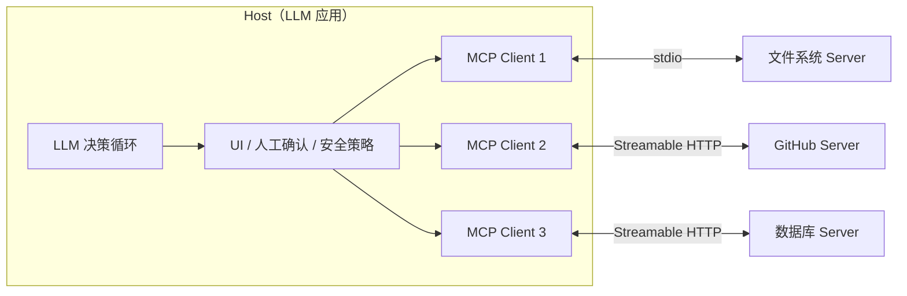
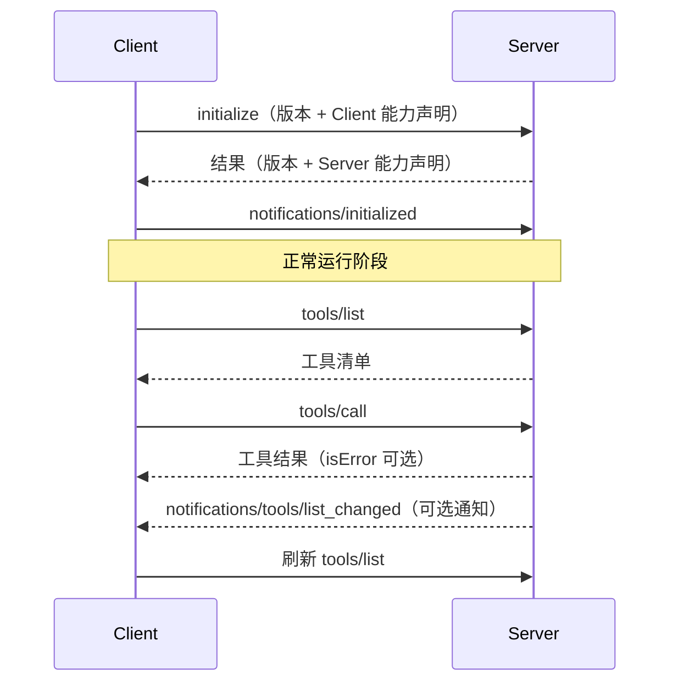

# MCP 协议深度解析：架构、传输层与能力协商

## 一、MCP 解决什么问题：从 M×N 到 M+N

在 MCP 出现之前，把大语言模型应用接到外部数据源和工具上是一个组合爆炸问题。假设有 M 个 LLM 应用（IDE 插件、聊天客户端、Agent 框架），N 个外部能力来源（GitHub、数据库、文件系统、S3……）。每个应用想接入每个数据源，都需要单独写一套适配代码：鉴权方式不同、数据格式不同、工具调用约定不同。总集成成本是 M×N。

```text
M×N 时代：每个应用为每个数据源写专属集成

  Claude Desktop ──── GitHub API（专用适配器）
  IDE 插件 ────────── Postgres（专用适配器）
  自研 Agent ──────── S3（专用适配器）
  ...（每个应用 × 每个数据源 = M×N 套代码）
```

MCP 的思路是把这个问题重新切分：所有应用实现同一套客户端协议，所有数据源实现同一套服务端协议，双方通过一个开放的、与具体厂商无关的标准通信。集成成本从 M×N 降为 M+N——每个应用写一次客户端，每个数据源写一次 Server，中间靠协议对接。

```text
M+N 时代：协议作为统一中间层

  Claude Desktop ─┐                     ┌─ GitHub Server
  IDE 插件 ───────┼── MCP 协议 ──────────┼─ Postgres Server
  自研 Agent ─────┘   （统一消息模型）     └─ S3 Server
```

这与 USB-C 的类比很贴切：USB-C 统一了供电、数据传输、视频输出的物理接口与协商协议，设备厂商只需要实现一次，就能插到所有主机上。MCP 做的是同样的事，只不过"设备"是工具与数据源，"主机"是 LLM 应用。

但 MCP 不是简单的 RPC 框架。它定义的不只是"怎么传消息"，还包括语义层：什么是工具、什么是资源、什么是提示词模板，客户端如何发现它们、服务端如何描述它们、双方如何协商各自支持的能力。这些正是本文的重点。

## 二、三种角色：Host、Client、Server

MCP 规范把参与方拆成三个角色，初学者最容易混淆的是 Host 和 Client 的区别。

- **Host（宿主）**：用户直接使用的 LLM 应用，比如 Claude Desktop、Cursor、某个 Agent 框架的运行时。Host 负责：管理 LLM 的对话与决策循环、持有用户会话、控制 UI、决定何时把工具结果喂给模型、执行安全策略（如人工确认）。Host 自己不直接和 Server 通信。
- **Client（客户端）**：运行在 Host 内部的连接器。一个 Host 可以同时维护多个 Client，每个 Client 与一个 Server 建立 1:1 的有状态连接。Client 负责协议层面的事：能力协商、消息路由、请求转发。
- **Server（服务端）**：暴露具体能力的轻量进程。一个 Server 通常聚焦一个领域（文件系统、GitHub、数据库），通过三大原语（tools/resources/prompts）向 Client 提供能力，也可以反过来通过 sampling、roots 请求 Host 提供能力。

关键点：**Client 与 Server 的连接是有状态且一一对应的**。如果 Host 接入了三个 Server，内部就有三个 Client 实例，各自维护独立的协议状态机。Server 之间互不可见，Server 也无法知道 Host 还接了谁——这是后续讨论 confused deputy 攻击的协议基础。



一个值得注意的设计决策：MCP 明确规定 **Host 掌控所有控制流**。Server 请求 sampling 时，请求先到 Client，再由 Host 决定是否让 LLM 处理、用什么模型处理、最终是否采信结果。Server 从不直接调用模型 API。这个"Host 中间人"的设计是 MCP 安全模型的基石，也是它区别于"给 Server 一个 API key 直接调 LLM"这种朴素方案的核心。

## 三、消息模型：站在 JSON-RPC 2.0 肩膀上

MCP 的线格式（wire format）直接采用 JSON-RPC 2.0。所有消息都是 UTF-8 编码的 JSON 文本，分为三类：

**1. Request（请求）**：期望得到响应的消息，携带递增的 `id`：

```json
{
  "jsonrpc": "2.0",
  "id": 1,
  "method": "tools/call",
  "params": {
    "name": "search_note",
    "arguments": { "query": "协议设计" }
  }
}
```

**2. Response（响应）**：与请求 `id` 配对。成功时返回 `result`，失败时返回 `error`：

```json
{
  "jsonrpc": "2.0",
  "id": 1,
  "result": {
    "content": [{ "type": "text", "text": "找到 3 条相关笔记..." }],
    "isError": false
  }
}
```

```json
{
  "jsonrpc": "2.0",
  "id": 1,
  "error": { "code": -32602, "message": "Invalid params: query is required" }
}
```

**3. Notification（通知）**：单向消息，无 `id`，不期望响应。典型如资源变更通知 `notifications/resources/list_changed`、日志通知 `notifications/message`：

```json
{
  "jsonrpc": "2.0",
  "method": "notifications/tools/list_changed"
}
```

理解 MCP 报错模型有一个容易踩坑的细节：`tools/call` 的**工具执行失败**不返回 JSON-RPC `error`，而是在 `result` 里带 `isError: true`。原因是工具失败对 LLM 来说是"正常输入"——模型需要读到失败原因才能自我纠正，而 JSON-RPC error 是给协议层排查用的。规范对错误层级的划分是：

- **协议级错误**（JSON-RPC error code）：方法不存在（`-32601`）、参数非法（`-32602`）、传输层故障；
- **工具执行错误**（`isError: true` + 文本内容）：文件找不到、SQL 报错、权限不足——这些信息预期会被 LLM 消费。

协议中所有方法名采用 `类别/动作` 的命名空间形式：`initialize`、`tools/list`、`tools/call`、`resources/read`、`prompts/get`、`sampling/createMessage` 等。通知统一加 `notifications/` 前缀。

## 四、传输层：stdio 与 Streamable HTTP

MCP 目前定义两种标准传输，消息内容相同，区别只在"字节怎么搬"。

### stdio：本地进程直连

Client 以子进程方式启动 Server（例如 `npx @modelcontextprotocol/server-filesystem`），通过标准输入输出通信：Client 把 JSON-RPC 消息写入 Server 的 stdin，Server 把响应写到 stdout，一行一个完整 JSON 消息（newline-delimited）。stderr 保留给 Server 自己的日志，绝不能往 stdout 混入非协议内容——这是 stdio Server 最常见的开发事故。

stdio 的特点：

- 零网络配置，天然本地，适合访问本地文件、本地命令；
- 生命周期与 Host 进程绑定，Host 退出即 Server 退出；
- 1:1 独占，Server 无需处理并发客户端；
- 无法远程部署，Server 必须与 Host 在同一台机器。

### Streamable HTTP：远程与多客户端

2025-03 版规范引入 Streamable HTTP，取代了此前陈旧且难以水平扩展的 HTTP+SSE 双端点方案。它的工作方式：

1. Client 向 Server 的单一 MCP 端点发送 `POST`，body 是 JSON-RPC 消息，`Accept` 头同时声明 `application/json` 和 `text/event-stream`；
2. 简单请求（如 `initialize`、`tools/call`）Server 直接回一个 JSON；
3. 需要流式多条消息（如长任务进度、服务器主动通知）时，Server 回一个 `text/event-stream`，在同一响应里用 SSE 持续推送多条 JSON-RPC 消息；
4. Server 可选择性地提供 `GET` 端点，建立 SSE 长连接用于服务器主动推送（该能力是可选的，这让无状态部署成为可能）；
5. Server 通过响应头 `Mcp-Session-Id` 分配会话标识，Client 后续请求必须携带它，实现有状态会话；Server 也可以随时用 HTTP 405 或 `DELETE` 流程回收会话。

| 维度 | stdio | Streamable HTTP |
|------|-------|-----------------|
| 部署位置 | 本地子进程 | 本地或远程 |
| 多客户端 | 不支持（独占） | 支持，可水平扩展 |
| 会话状态 | 进程即会话 | `Mcp-Session-Id` 显式管理 |
| 鉴权 | 无（本地信任） | OAuth 2.1（2025-06 起） |
| 典型场景 | 文件系统、本地 CLI 封装 | SaaS 集成、团队共享 Server |

选型建议：能本地解决的用 stdio——简单、快、零鉴权负担；需要远程访问、多用户共享、Server 由第三方托管时用 Streamable HTTP。两者可以让同一个 Server 同时支持：stdio 用于开发调试，Streamable HTTP 用于生产部署。

## 五、连接生命周期：initialize 握手与能力协商

MCP 连接的建立是一个严格的三步握手，任何一步的顺序错误都会导致协议失败。

### 第 1 步：Client 发出 initialize 请求

```json
{
  "jsonrpc": "2.0",
  "id": 0,
  "method": "initialize",
  "params": {
    "protocolVersion": "2025-06-18",
    "capabilities": {
      "roots": { "listChanged": true },
      "sampling": {}
    },
    "clientInfo": { "name": "my-agent", "version": "1.2.0" }
  }
}
```

注意 Client 在这里声明的 `capabilities` 是 **Client 自己的能力**：支持 roots 且变更会发通知（`listChanged: true`）、支持 sampling。这里最容易犯的理解错误是以为 capabilities 是"我想要什么"，实际上是"我这边能提供什么"——能力协商是双向的，各自声明自己能服务对方的东西。

### 第 2 步：Server 回应自己的版本与能力

```json
{
  "jsonrpc": "2.0",
  "id": 0,
  "result": {
    "protocolVersion": "2025-06-18",
    "capabilities": {
      "tools": { "listChanged": true },
      "resources": { "subscribe": true }
    },
    "serverInfo": { "name": "note-server", "version": "0.3.0" }
  }
}
```

版本协商规则：如果 Client 请求的版本 Server 支持，就用该版本回应；不支持则回 Server 自己支持的最新版本，由 Client 决定是否继续。这一步之后，双方才知道对方"听得懂哪些话"。

### 第 3 步：Client 发出 initialized 通知

```json
{ "jsonrpc": "2.0", "method": "notifications/initialized" }
```

这是一条通知而非请求——不需要响应，它只是声明"协商完成，可以进入正常运行阶段"。此后 Client 才可以开始 `tools/list`、`resources/list` 等正常操作。



能力协商的实际意义在于**按需加载与向前兼容**：Server 只需要实现它声明的能力，Client 只需要处理它声明过要处理的消息。Server 不支持 resources 就不会收到 `resources/read`；Client 不支持 sampling，Server 声明了也不该调用。加上 `listChanged` 之类的子开关，连"列表会不会动态变化"都能协商。协议版本演进时，旧 Client 与新 Server 也能通过协商回退到共同支持的版本。

## 六、三大核心原语：tools、resources、prompts

这是 MCP 语义层的核心，也是实践中最容易被混用的部分。三者分别对应 LLM 应用中三个不同的控制主体。

### tools：模型控制的动作

**Tools 是"给模型用的"**——由 LLM 决定何时调用。每个工具是一个可执行动作，带有 JSON Schema 描述的输入参数，可能产生副作用（写文件、发请求、执行 SQL）。典型流程：Host 从各 Client 聚合工具清单 → 把清单（通常是工具名+描述+参数 schema）放进系统提示 → 模型在对话中决定调用 → Host 经由对应 Client 发 `tools/call` → 结果回填对话上下文。

```json
{
  "name": "search_note",
  "description": "按关键词全文检索用户的笔记，返回标题与片段",
  "inputSchema": {
    "type": "object",
    "properties": {
      "query": { "type": "string", "description": "检索关键词" }
    },
    "required": ["query"]
  }
}
```

判断标准：**如果这个操作需要模型"决定做不做、什么时候做"，它就是 tool**。副作用大、需要人工确认的操作尤其应该做成 tool，因为控制权在模型，而确认门在 Host。

### resources：应用控制的数据

**Resources 是"给应用用的"**——由 Host 应用决定加载什么进上下文，模型是被投喂的一方。Resource 用 URI 标识（如 `file:///notes/2026/arch.md` 或自定义 scheme `notes://arch`），内容可以是文本或 blob。它是只读的、无副作用的、面向"上下文补全"的数据源。

与 tools 的关键差异：

| 维度 | tools | resources |
|------|-------|-----------|
| 控制主体 | LLM 决定调用 | 应用/用户决定读取 |
| 副作用 | 可能有（写、删、执行） | 只读 |
| 发现方式 | 模型看到工具清单 | UI 里让用户挑选，或应用自动附带 |
| 类比 | POST/动作端点 | GET/数据端点 |

Resource 还支持 **resource template**（如 `notes://{category}/{date}`），允许用 URI 模板参数化地引用一类资源，由应用或用户填参后取值。此外 2025-03 版加入了 **订阅**：Client 可对某个 resource 发起订阅，内容变化时 Server 推送更新通知——这让"把文档实时挂进上下文"成为可能。

### prompts：用户控制的模板

**Prompts 是"给用户用的"**——由用户主动从 UI 选择触发。一个 prompt 是带参数的提示词模板，Server 暴露它，Host 在界面上呈现为斜杠命令或菜单项（比如用户输入 `/summarize-note`），选中后 Host 取回模板渲染结果，作为一段消息注入对话。

三者的控制权划分可以总结为一句话：**tools 模型控制，resources 应用控制，prompts 用户控制**。把操作放错原语是常见的设计反模式——比如把"读取配置文件"做成 tool，结果模型每次都要"决定"读一下，既浪费一轮工具调用又可能被注入操纵；正确做法是做成 resource，让应用在合适的时机自动附带。

## 七、高级能力：sampling 与 roots

MCP 不只是"Server 给 Host 提供能力"，还有两个反向原语让 Server 借用 Host 的能力。

**Sampling（采样）**：Server 通过 `sampling/createMessage` 请求 Host 代为调用 LLM。请求里带消息列表、模型偏好（可以只给"智力优先/成本优先"这类倾向性提示而非具体型号）、采样参数。Host 收到后：审查请求 → 选自己的模型执行 →（通常）让用户过目 → 把结果返回 Server。典型用途：一个翻译 Server 内部需要"再让模型润色一遍"，或者代码分析 Server 需要模型帮忙总结 AST。设计上的精妙之处在于 Server **无需持有任何模型 API key**，成本与模型选择都由 Host 治理。

**Roots（根目录）**：Client 把一组文件系统 URI（如 `file:///home/user/project-a`）告知 Server，作为"建议你关注的工作空间边界"。注意它只是建议性的约束声明，不是安全沙箱——Server 仍然应该自律地只访问 roots 之内，真正的强制隔离要靠操作系统层 sandboxing。Roots 支持 `listChanged` 通知：用户在 Host 里切换了项目目录，Server 会收到变更通知并调整关注范围。

这两个原语共同体现了 MCP 的架构取向：**能力不对称但互补**。Server 提供领域数据与动作，Host 提供模型算力与文件上下文，双方通过协商各取所需。

## 八、协议版本演进：2024-11 到 2025-06

MCP 的协议版本号是日期制，目前经历了三个正式版本，理解演进方向有助于判断生态走向。

**2024-11-05（首发版）**：确立三角色架构、JSON-RPC 2.0 消息模型、三大原语、stdio 与 HTTP+SSE 传输。问题也很快暴露：HTTP+SSE 要求 Server 维持两个端点、连接粘性、难以在无状态基础设施（如 Serverless）上部署。

**2025-03-26**：三个重点变化。第一，用 Streamable HTTP 取代 HTTP+SSE——单端点、可选流式、支持无头无状态部署，这是传输层最大的一次改造；第二，新增 **OAuth 2.1 授权框架**，为远程 Server 定义了标准化的鉴权路径（后文安全篇详述）；第三，tools 支持 `annotations`（`readOnlyHint`、`destructiveHint` 等），resources 支持订阅。

**2025-06-18**：第一，**鉴权体系大幅重构**——明确了 MCP Server 是 OAuth Resource Server 的定位，引入 Protected Resource Metadata，支持 Token Audience Binding（token 必须显式声明受众 Server，防止 token 在多个 Server 间混用）；第二，协议版本改为在 initialize 之后通过 HTTP 头 `MCP-Protocol-Version` 持续声明，避免长连接中的版本歧义；第三，工具输出新增 **structured content**（`structuredContent` 字段），工具可以返回带 schema 的结构化数据而不仅仅是给模型看的文本；第四，stdio 传输明确要求使用 `MCP-Protocol-Version` 头的等价物（通过初始化参数传递），并强化了 elicitation（服务端向用户索取结构化输入）等能力。

从演进脉络可以读出两个方向：一是**从本地走向远程**（传输改造 + OAuth），MCP 正在成为跨组织的 Web 级协议；二是**从文本走向结构**（structured output、elicitation），协议正在为 Agent 工作流中的机器对机器交互做精化。下一篇文章我们将基于 2025-06 版规范，用 Python SDK 实战构建一个生产级 Server；第三篇再深入它的安全模型。

## 参考资料

- MCP 官方规范：<https://modelcontextprotocol.io/specification>
- MCP 官方网站与 SDK 仓库：<https://github.com/modelcontextprotocol>
- JSON-RPC 2.0 规范：<https://www.jsonrpc.org/specification>
