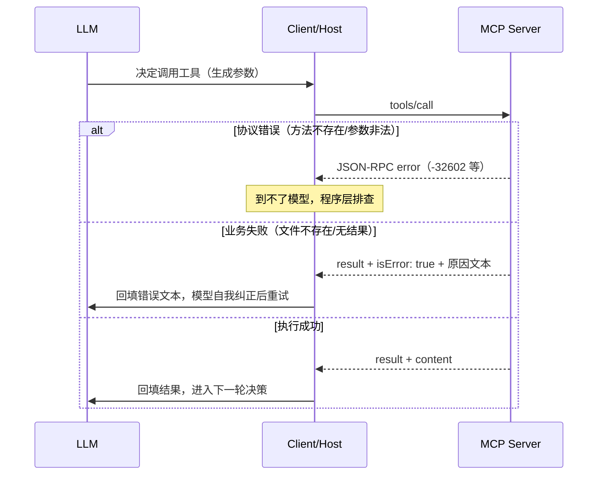

# MCP Server 实战：用 Python SDK 从零构建生产级 Server

上一篇我们拆解了 MCP 的协议架构与三大原语。这一篇动手：用官方 Python SDK（mcp 包）的 FastMCP 高层 API，从零构建一个可以真正部署的"文件笔记服务器"。它很小，但会覆盖生产级 Server 的所有关键面：参数校验、资源模板、Prompt、结构化输出、错误处理、生命周期管理、远程部署与调试。

## 一、环境准备

Python 版本要求 3.10 及以上。一条命令安装官方 SDK：

```bash
pip install "mcp[cli]"
```

`mcp[cli]` 额外装了 `mcp` 命令行工具（起 MCP Inspector 用）。先建项目骨架：

```text
note-server/
├── server.py        # 主文件，本文所有代码都在这里演进
├── notes/           # 笔记存储目录（JSON 文件）
└── requirements.txt # mcp[cli]>=1.9.0
```

FastMCP 是官方 SDK 里的高层封装（注意不要与社区早期同名项目混淆）：把 `@mcp.tool()` 这类装饰器下面的函数直接注册为 MCP 能力，函数签名经 pydantic 自动转为 JSON Schema。协议握手、消息编解码、传输层全部由它托管。

## 二、最小可运行 Server 与三大原语骨架

先写出能跑起来的骨架，再逐步填充。目标能力清单：

- tools：`add_note`（写）、`list_notes`（列）、`search_note`（搜）
- resources：单篇笔记读取 + 笔记列表，带 resource template
- prompts：`summarize_note` 笔记摘要模板

```python
"""文件笔记服务器：MCP 实战主文件"""
import json
import re
import sqlite3
from datetime import datetime
from pathlib import Path
from typing import Annotated

from mcp.server.fastmcp import FastMCP
from pydantic import Field

# 笔记存储目录与索引数据库
NOTE_DIR = Path(__file__).parent / "notes"
NOTE_DIR.mkdir(exist_ok=True)

# 创建 FastMCP 实例，名字会出现在 initialize 的 serverInfo 里
mcp = FastMCP("note-server")
```

## 三、实现 tools：参数校验交给 pydantic

工具函数就是普通 Python 函数，签名上的类型注解和 `Annotated` 描述会被 FastMCP 自动转成 `inputSchema`，并在调用时做参数校验。校验失败时 SDK 会自动返回带错误信息的 `isError: true` 结果，无需手写校验代码。

```python
def _slugify(title: str) -> str:
    """把标题转成安全的文件名片段"""
    return re.sub(r"[^\w\u4e00-\u9fff-]", "_", title.strip())[:60]


@mcp.tool()
def add_note(
    title: Annotated[str, Field(description="笔记标题，作为文件名来源")],
    content: Annotated[str, Field(min_length=1, description="笔记正文，支持 Markdown")],
    tags: Annotated[list[str], Field(default_factory=list, description="标签列表")] = None,
) -> str:
    """新增一条笔记，保存为 notes 目录下的 JSON 文件，返回文件路径"""
    tags = tags or []
    note_id = _slugify(title)
    note = {
        "id": note_id,
        "title": title,
        "content": content,
        "tags": tags,
        "created_at": datetime.now().isoformat(),
    }
    path = NOTE_DIR / f"{note_id}.json"
    path.write_text(json.dumps(note, ensure_ascii=False, indent=2), encoding="utf-8")
    # 写完主动失效缓存，让资源列表保持最新（见第六节 lifespan）
    return f"笔记已保存：{path.name}"


@mcp.tool()
def list_notes() -> list[dict]:
    """列出全部笔记的标题与标签（不返回正文）"""
    result = []
    for path in sorted(NOTE_DIR.glob("*.json")):
        note = json.loads(path.read_text(encoding="utf-8"))
        result.append({
            "id": note["id"],
            "title": note["title"],
            "tags": note.get("tags", []),
        })
    return result


@mcp.tool(
    annotations={
        "readOnlyHint": True,
        "title": "搜索笔记",
    }
)
def search_note(
    query: Annotated[str, Field(min_length=1, description="检索关键词，对标题与正文做大小写无关匹配")],
) -> list[dict]:
    """按关键词搜索笔记，返回命中笔记的摘要片段"""
    hits = []
    q = query.lower()
    for path in NOTE_DIR.glob("*.json"):
        note = json.loads(path.read_text(encoding="utf-8"))
        if q in note["title"].lower() or q in note["content"].lower():
            # 只给模型片段，避免整篇笔记撑爆上下文
            idx = note["content"].lower().find(q)
            start = max(0, idx - 40)
            snippet = note["content"][start:idx + 60]
            hits.append({"id": note["id"], "title": note["title"], "snippet": f"...{snippet}..."})
    return hits
```

三个值得展开的实现细节。

**1. annotations 的语义。** `readOnlyHint: True` 声明 `search_note` 没有副作用。注意规范里所有 `*Hint` 都是"提示而非保证"——客户端可以据此决定是否跳过人工确认门，但 Server 不能撒谎：把破坏性工具标成只读，会在客户端信任模型里留下安全漏洞。常用的还有 `destructiveHint`（破坏性操作）、`idempotentHint`（可重复执行）、`openWorldHint`（是否访问外部世界）。

**2. 返回值设计是写给 LLM 看的。** 工具结果最终进入模型上下文。`list_notes` 只返回标题与标签而非全文，`search_note` 只返回 60 字符片段——上下文是稀缺资源，工具描述与返回体量要在"信息够模型决策"与"不撑爆窗口"之间平衡。

**3. pydantic 校验即文档。** `Field(min_length=1)`、description 都会进入 JSON Schema，模型据此生成参数。与其在函数体里写 `if not query: raise ...`，不如把约束声明在签名上。

## 四、resources：静态、动态与 resource template

资源是应用控制的只读数据。FastMCP 用 `@mcp.resource("uri")` 注册，URI 里带 `{param}` 即自动成为 resource template。

```python
@mcp.resource("notes://list")
def get_note_list() -> str:
    """静态资源：全部笔记索引，应用可以直接挂进上下文"""
    items = [
        json.loads(p.read_text(encoding="utf-8"))["title"]
        for p in NOTE_DIR.glob("*.json")
    ]
    return "\n".join(f"- {t}" for t in items) or "（暂无笔记）"


@mcp.resource("notes://{note_id}")
def get_note(note_id: str) -> str:
    """动态资源：按 ID 读取单篇笔记全文"""
    path = NOTE_DIR / f"{note_id}.json"
    if not path.exists():
        # 资源不存在：直接抛异常，SDK 会转成协议错误
        raise FileNotFoundError(f"笔记 {note_id} 不存在")
    note = json.loads(path.read_text(encoding="utf-8"))
    return f"# {note['title']}\n\n{note['content']}"
```

URI `notes://{note_id}` 就是一个 resource template：Client 端可以用它生成"这个参数给我填什么"的交互（例如 Host UI 弹出输入框），填好后按实际 URI 读取。静态与动态的分界：URI 固定的是静态资源（应用启动时即可枚举）；带模板参数的是动态资源，适合"按需取值"的场景。

MIME 类型由返回值推断（str 按文本），需要精确控制时可显式指定 `@mcp.resource("notes://report", mime_type="application/json")` 并返回 dict。

## 五、prompts：用户主动触发的模板

Prompt 是用户在 Host 界面上点选的模板，函数参数即模板参数：

```python
@mcp.prompt()
def summarize_note(
    note_id: Annotated[str, Field(description="要摘要的笔记 ID")],
    style: Annotated[str, Field(description="摘要风格：brief 或 detailed")] = "brief",
) -> list:
    """生成笔记摘要提示词，用户选择后注入对话"""
    path = NOTE_DIR / f"{note_id}.json"
    note = json.loads(path.read_text(encoding="utf-8")) if path.exists() else None
    note_text = note["content"] if note else f"（笔记 {note_id} 尚未找到，请先用 search_note 检索）"

    return [
        {
            "role": "user",
            "content": (
                f"请为以下笔记生成{'一段简短' if style == 'brief' else '一份详细'}摘要，"
                f"保留关键结论与待办事项。\n\n---\n{note_text}\n---"
            ),
        }
    ]
```

注意 prompt 函数里我们**不做**"找不到就报错"的硬失败，而是把"没找到"作为信息放进提示词，让模型自己决定下一步（比如调用 search_note）。这是 prompt 与 tool 错误处理的语义差异：prompt 是上下文构造，tool 是动作执行。

## 六、错误处理：isError、异常与"写给 LLM 看"

MCP 的错误处理有两条独立路径，混用是新手最常见的 bug 来源。先用一张图看清一次工具调用中错误的流转：



**路径 1：协议错误（JSON-RPC error）。**

**路径 1：协议错误（JSON-RPC error）。** 参数不合法、方法不存在、内部崩溃——SDK 自动抛 `-32602`、`-32601` 等标准错误码。资源不存在时抛 `FileNotFoundError`（如上节）也走这条路。这类错误**到达不了模型**，是给 Client 程序排查用的。

**路径 2：工具执行错误（isError: true）。** 工具跑起来了但业务上失败——文件不存在、搜索无结果、权限不足。这不该走协议错误，而应返回错误文本让模型读到并自我纠正：

```python
@mcp.tool()
def update_note(
    note_id: Annotated[str, Field(description="要更新的笔记 ID")],
    content: Annotated[str, Field(description="新的正文内容")],
) -> str:
    """更新指定笔记的正文"""
    path = NOTE_DIR / f"{note_id}.json"
    if not path.exists():
        # 业务失败：返回 isError 结果，让 LLM 看到失败原因并尝试补救
        existing = ", ".join(p.stem for p in NOTE_DIR.glob("*.json")) or "（空）"
        return (
            f"更新失败：笔记 {note_id} 不存在。当前可用的笔记 ID 有：{existing}。"
            f"请先用 list_notes 确认后重试。"
        )
    note = json.loads(path.read_text(encoding="utf-8"))
    note["content"] = content
    note["updated_at"] = datetime.now().isoformat()
    path.write_text(json.dumps(note, ensure_ascii=False, indent=2), encoding="utf-8")
    return f"笔记 {note_id} 已更新"
```

错误信息要**写给 LLM 看**——这是设计原则而不是修辞。上面失败的返回里包含了：失败原因、当前可用的合法值、下一步建议。模型拿到这种错误，下一轮就能自己修正参数重试，而不是卡死在"Invalid note id"的字符串上反复失败。

经验法则：**可恢复的业务失败 → isError 文本；不可恢复的内部故障 → 抛异常**。不要用异常吞掉业务失败（模型看不见），也不要用 isError 报告代码 bug（那会误导模型去"重试"一个永远不会成功的事）。

## 七、structured output：结构化返回

2025-06 版规范给 tools/call 增加了 `structuredContent` 字段：当工具的返回值有明确的类型注解（非 str）时，FastMCP 会自动生成 `outputSchema` 并把返回值放进结构化通道，同时仍生成一段文本内容兜底。

```python
@mcp.tool()
def note_stats() -> dict:
    """返回笔记库的统计信息（结构化输出）"""
    notes = [json.loads(p.read_text(encoding="utf-8")) for p in NOTE_DIR.glob("*.json")]
    return {
        "total": len(notes),
        "with_tags": sum(1 for n in notes if n.get("tags")),
        "latest": max((n["created_at"] for n in notes), default=None),
    }
```

返回 dict 时 SDK 推导 outputSchema，Client 程序可以直接消费 `result["structuredContent"]["total"]`，不必解析自然语言。文本内容与结构化内容并存的原因：模型读文本，程序读结构。需要更严格的 schema 时可用 pydantic BaseModel 作为返回类型注解。

## 八、lifespan：管理数据库连接

笔记多了以后，JSON 文件扫描太慢，换 SQLite。数据库连接要跨请求复用，但不能用模块级全局变量（不利于测试与多实例），正确姿势是 FastMCP 的 lifespan：

```python
from contextlib import asynccontextmanager

DB_PATH = NOTE_DIR / "index.db"

@asynccontextmanager
async def app_lifespan(server: FastMCP):
    """服务器生命周期：启动时建库建表，关闭时释放连接"""
    conn = sqlite3.connect(DB_PATH, check_same_thread=False)
    conn.execute(
        """CREATE TABLE IF NOT EXISTS notes (
            id TEXT PRIMARY KEY,
            title TEXT NOT NULL,
            content TEXT NOT NULL,
            tags TEXT NOT NULL DEFAULT '[]',
            created_at TEXT NOT NULL
        )"""
    )
    conn.commit()
    # 通过依赖注入把连接传给所有工具
    server.state.conn = conn
    try:
        yield conn
    finally:
        conn.close()


mcp = FastMCP("note-server", lifespan=app_lifespan)


@mcp.tool()
def search_note_fast(
    query: Annotated[str, Field(min_length=1, description="SQLite 全文检索关键词")],
) -> list[dict]:
    """基于数据库索引快速搜索笔记"""
    conn = mcp.state.conn  # lifespan 注入的连接
    rows = conn.execute(
        "SELECT id, title FROM notes WHERE title LIKE ? OR content LIKE ? LIMIT 20",
        (f"%{query}%", f"%{query}%"),
    ).fetchall()
    return [{"id": r[0], "title": r[1]} for r in rows]
```

lifespan 的语义：`yield` 之前在 initialize 阶段执行（建库建表），`yield` 挂起期间服务所有请求，连接断开后执行 `finally` 清理。`server.state` 是官方推荐的对象挂载点——工具函数里通过 `mcp.state` 取用。

## 九、部署：Streamable HTTP 支持多客户端

开发期用 stdio 最方便，写完直接注册进 Claude Desktop 或 MCP Inspector：

```json
{
  "mcpServers": {
    "note-server": {
      "command": "python",
      "args": ["-m", "server"]
    }
  }
}
```

生产部署换 Streamable HTTP，FastMCP 内置了 ASGI 应用，一行切换：

```python
if __name__ == "__main__":
    # 本地开发（stdio）：
    # mcp.run()
    # 生产部署（Streamable HTTP，默认 8000 端口，路径 /mcp）：
    mcp.run(transport="streamable-http")
```

```bash
python server.py
# Server 监听 http://0.0.0.0:8000/mcp，每个客户端连接由 Mcp-Session-Id 区分
```

多客户端场景下要注意三件事：

1. **会话隔离**：Streamable HTTP 的每个 Client 会话独立，但 `server.state` 是进程级共享——SQLite 连接天然可共享（`check_same_thread=False`），换成别的资源时要评估并发安全；
2. **并发上限**：底层是 uvicorn/anyio，多客户端并发受进程线程池约束，高并发部署建议改用 `mcp.run(transport="streamable-http")` 背后的 `mcp.streamable_http_app()` 挂到自己的 ASGI 服务上，配合多 worker；
3. **鉴权**：本文示例未加鉴权，生产环境前面必须放反代或按 2025-06 规范实现 OAuth（见本系列第三篇）。

## 十、调试：MCP Inspector

MCP Inspector 是官方调试器，一条命令启动：

```bash
mcp dev server.py
```

浏览器会打开调试界面，四个面板对应调试的四个层次：

- **Tools / Resources / Prompts**：直接列出并手工调用，验证 schema 描述与返回内容——重点看工具描述是否清晰到"你自己愿意照着写参数"；
- **错误路径**：故意传非法参数（空字符串、不存在的 note_id），确认失败走的是预期的错误路径（isError 还是协议错误）；
- **传输切换**：Inspector 支持以 stdio 或 HTTP 连接同一个 Server，部署前用 HTTP 模式过一遍，模拟真实客户端的 `Mcp-Session-Id` 会话流；
- **日志面板**：查看 Server 侧 stderr 日志与协议通知。

没有 UI 环境时，也可以用原始方式：`echo` 一条 initialize 消息进 stdin，肉眼验证响应 JSON——协议是纯文本 JSON，awk 都能调试。

## 十一、上线前检查清单

- [ ] 每个工具的 description 与参数描述写成"给 LLM 的说明书"，而非开发者注释
- [ ] 业务失败返回 isError + 可操作的错误信息（含合法值与下一步建议）；代码 bug 才抛异常
- [ ] 返回体量经过裁剪（片段化、分页、字段最小化），不会单次调用撑爆上下文
- [ ] 破坏性工具正确声明 annotations（destructiveHint 等），绝不给只读工具撒谎标记
- [ ] 生命周期资源（连接、文件句柄）在 lifespan 中创建与释放，无模块级全局连接
- [ ] 共享状态评估过并发安全（SQLite 连接、缓存失效、临时文件）
- [ ] stdio 模式下 stdout 只有协议消息，日志全部走 stderr
- [ ] HTTP 部署有鉴权层（至少反代 + Token），CORS 收紧到需要的 Host
- [ ] 用 MCP Inspector 以生产同款传输方式完整回归：正常路径、非法参数、边界值
- [ ] 版本号与 serverInfo 元信息可追溯，协议版本锁定在测试过的 2025-06-18

## 参考资料

- MCP Python SDK：<https://github.com/modelcontextprotocol/python-sdk>
- FastMCP 文档：<https://gofastmcp.com>
- MCP Inspector：<https://github.com/modelcontextprotocol/inspector>
- 2025-06-18 协议规范：<https://modelcontextprotocol.io/specification/2025-06-18>
