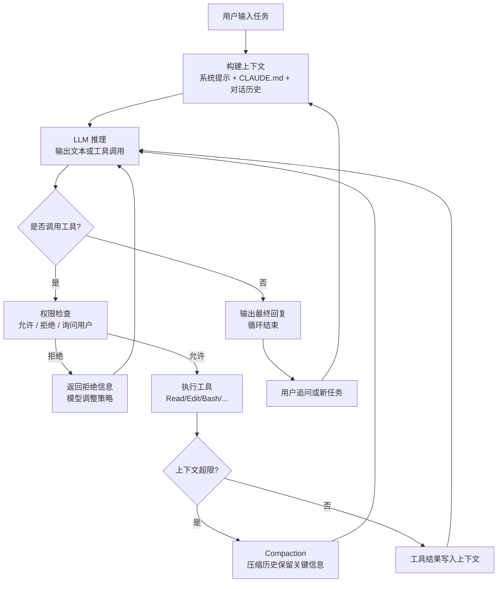

# 解码 Agent Harness：Claude Code 这类编码智能体的运行时到底做了什么

## 一个反直觉的结论：模型不是智能体的全部

2025 年之后，几乎每个团队都试过"用大模型 API + function calling 搭一个自己的 agent"。最常见的剧本是这样的：写一个循环，把用户消息和一堆工具定义塞进 system prompt，模型返回 tool_call 就执行，结果塞回去，直到模型不再调用工具为止。Demo 阶段看起来很惊艳，但一旦放到真实代码库里干活，很快就会暴露出各种问题：改错文件、绕远路、忘记之前的结论、在权限边界上反复横跳、上下文被工具输出撑爆。

与此同时，Claude Code、Codex CLI 这类产品在同样（甚至更早版本）的模型上表现稳定得多。差距在哪？不在模型，在模型之外的那一层工程设施。这一层，现在通常被称为 **Agent Harness**（智能体运行时/挽具）。

一句话定义：**Harness = LLM 之外的一切**。它包括 agentic 主循环、工具的定义与执行、权限与安全边界、状态与上下文管理、错误恢复机制。模型是发动机，Harness 是整辆车的底盘、变速箱、刹车和仪表盘。发动机相同，底盘不同，操控感受天差地别。

这篇文章就把 Claude Code 这类编码智能体的 Harness 拆开来看，里面每个部件为什么长成这个样子。

## Harness 的核心：一条单线程 while 循环

先破除一个误解：agentic loop 并不复杂。Claude Code 的核心主循环本质上就是：

```python
# 极简版 agentic 主循环
while True:
    response = llm.chat(messages, tools=tools)   # 1. 带着全部上下文请求模型
    if not response.tool_calls:                  # 2. 模型不再调工具 => 任务结束
        break
    for call in response.tool_calls:             # 3. 逐个执行工具
        result = execute_tool(call)              # 4. 真正干活的地方（含权限检查）
        messages.append(call)                    # 5. 调用记录进上下文
        messages.append(result)                  # 6. 结果进上下文
```

真正的工程含量藏在第 3、4、6 步里：

- **单线程、顺序执行**。Claude Code 刻意不搞复杂的并行编排。每轮只有一个推理、一组顺序执行的工具调用。原因很朴素：代码修改是有因果依赖的，并行写入会互相踩踏；而且单线程意味着上下文是一条清晰的因果链，出错时可回溯、可恢复。复杂度全部交给模型去理解，而不是交给编排框架。
- **工具结果原样回流**。每次工具调用的完整输出（包括错误）都会进入上下文，模型下一轮看到的是真实世界的反馈，而不是被中间层摘要过的信息。这是 agent 能"自我纠错"的前提——它必须看到失败长什么样。
- **终止条件由模型决定**。循环结束不是靠外部编排器判断"任务完成了没"，而是模型自己判断"不用再调工具了"。Harness 只负责兜底：最大轮数、用户打断、致命错误。



## 系统提示与项目记忆：行为塑造的第一现场

### 系统提示：一份"岗位说明书"

Claude Code 的系统提示相当长，而且写得极其具体。它不是"你是一个编程助手"这种空话，而是大量行为规则：

- 语气要求：回复简短直接，不要复述用户的话；
- 工具使用偏好：找代码用 Grep/Glob 而不是 ls；
- 编辑规范：优先用 Edit 做精确替换，改完不要主动跑格式化；
- 沟通纪律：遇到模糊需求先问，破坏性操作先确认。

这些规则本质上是把"一个好工程师的工作习惯"编译成了 prompt。模型默认行为和工程实践之间有大量缝隙，系统提示就是填缝用的。

### CLAUDE.md：分层加载的项目记忆

项目记忆通过 `CLAUDE.md` 文件实现，加载是分层的：

```text
~/.claude/CLAUDE.md          # 用户级：个人偏好，对所有项目生效
<repo>/CLAUDE.md             # 仓库级：构建命令、代码规范、架构约定
<repo>/src/CLAUDE.md         # 目录级：操作该目录下文件时才注入
```

这个设计的精妙之处在于：**项目知识以文件形式存在于代码库里，随代码一起版本管理**。团队成员各自提交自己踩过的坑（"测试要用 pnpm test，npm run test 会跑错目录"），所有人（以及所有人的 agent）自动受益。CLAUDE.md 不是文档，是注入到每次会话上下文里的活配置。

值得注意的是 Claude Code 后来把这个机制泛化了：`@import` 语法可以在 CLAUDE.md 里引用其他文件，memory 文件本身也可以用 Read 工具按需读取——这就把"常驻记忆"和"按需检索"连接了起来（这个话题在上下文工程那篇会展开）。

## 工具层：每个工具都是一个设计决策

Claude Code 的核心工具集只有十来个：Read、Edit、Write、Bash、Glob、Grep、Task（子智能体）、TodoWrite、WebFetch、WebSearch……数量克制，但每个都有明确的设计意图。

### 为什么强调 Grep/Glob 而不是开放式 ls？

一个经典的设计决策：给 agent 提供 ripgrep 封装的 Grep 和模式匹配的 Glob，而**不鼓励**用 `ls -R` 或 `find` 漫游目录。

原因有三：

1. **输出可控**。Grep 按行返回匹配结果，天然带文件名和行号，输出规模与匹配数成正比；`ls -R` 在大型仓库里可能吐出上万行，一轮就把上下文吃掉一大块。
2. **信息密度高**。agent 找代码靠的是语义线索（函数名、字符串常量），Grep 直接命中目标；目录树漫游是人类的探索方式，对 agent 是浪费。
3. **与下游工具衔接**。Grep 返回 `path:line` 格式，Read 可以按 offset/limit 精确读取，Edit 可以按 old_string 定位——整个工具链是围绕"精确定位、最小读取"设计的。

### Read 的分页与 Edit 的精确替换

Read 工具默认限制读取行数（约 2000 行），超长行截断，支持 offset/limit 分页。这不是功能限制，而是**上下文保护**：让模型养成"先看目录结构，再精确读取"的习惯，而不是一把梭把整个文件塞进上下文。

Edit 的 `old_string/new_string` 设计（而非行号 patch）则是为了对抗"模型数错行"——LLM 对行号的感知是出了名地不可靠，而对文本内容的复制是强项。这个设计的细节值得单独一篇，这里先按下不表。

### Bash：万能逃生舱口

Bash 工具看起来最朴素，其实是整个系统的安全阀。任何内置工具覆盖不了的场景（跑测试、装依赖、查 git 历史），都通过 Bash 兜底。设计上的关键约束是：Bash 输出会被截断（通常几万字符封顶），避免一条失控命令（比如 `cat` 一个巨大的日志）毁掉整个会话的上下文。

## 权限系统与 hooks：安全边界放在 harness 层而不是 prompt 层

很多自研 agent 把安全规则写在系统提示里："请不要删除文件"。这在 prompt injection 面前不堪一击。Claude Code 的做法是**权限硬边界**：

- 工具按风险分级：Read/Grep/Glob 只读免确认；Edit/Bash 默认需要批准（可配置白名单）；
- 权限规则可持久化：`.claude/settings.json` 里配置 `Bash(npm test:*)` 这类模式，命中即自动放行；
- 拒绝也是一种反馈：用户拒绝一次工具调用后，拒绝原因会作为工具结果回流，模型会调整策略而不是硬闯。

**hooks 机制**则提供了用户自定义的干预点：在 PreToolUse、PostToolUse、Stop 等生命周期事件上挂用户脚本，脚本可以拦截、修改或否决工具调用。比如"任何 `git push --force` 直接阻断"。规则在代码里，不在 prompt 里——这是 harness 思维和 prompt 思维的分水岭。

## 子智能体：用上下文隔离换纪律

Task 工具（subagent）是 Claude Code 架构里最容易被低估的一环。它做的事情：派生一个全新的、拥有独立上下文的 agent 实例，交给它一个自包含的任务（比如"搜索这三个模块里所有用到 X 的地方"），干完后**只把最终结论回传到主上下文**。

这解决了两个问题：

1. **上下文污染**。一次大规模搜索可能产生几万 token 的中间结果，如果发生在主上下文里，这些噪声会伴随整个会话。子智能体相当于一次性手套——脏活干完就丢。
2. **注意力稀释**。主上下文里塞满了无关细节后，模型对当前任务的注意力会下降（上下文腐烂问题）。隔离让主 agent 始终保持"干净的案头"。

代价是信息压缩损耗：子智能体只回传结论，主 agent 看不到过程中的细节。所以什么该派出去（探索、调研、批量验证）、什么必须留在主上下文（核心代码修改），是使用 subagent 的关键判断。

## 长任务的三根支柱：todo、compaction 与错误恢复

### TodoWrite：外置的工作记忆

LLM 在多步任务中的典型病症是"漂移"：做到第 5 步忘了第 2 步的约束。TodoWrite 工具让模型把计划外置成结构化列表（pending/in_progress/completed），每完成一步就更新。这本质上是给模型配了一个**外部工作记忆**，用工具调用的仪式感强制对齐目标。实测中它对 10 步以上任务的完成率影响显著。

### Compaction：上下文的垃圾回收

会话足够长时，上下文窗口会被打满。Claude Code 的处理方式是 compaction：把对话历史交给模型做一次结构化摘要（保留任务目标、关键决策、文件路径、未完成事项），然后用摘要替换原始历史，会话继续。这相当于给主循环加了一个 GC——它不完美（细节有损），但让"连续工作数小时"成为可能。触发时机和保留策略的细节，同样留到上下文工程那篇展开。

### 错误恢复：失败是数据，不是异常

Harness 对错误的态度决定了 agent 的韧性。工具执行失败（测试不过、编译报错、权限拒绝）不会被当成异常抛出终止流程，而是作为普通工具结果回流上下文——模型看到错误信息，下一轮自己想办法。配合 git 的原子性（修改前可回滚），Claude Code 敢于尝试激进的修复方案，失败了退回来换条路。**允许廉价失败，才有真正的自主性。**

## 对比：裸 API + function calling 到底缺什么

把前面所有组件收拢，一张表看清自研 agent 和成熟 harness 的差距：

| 组件 | 裸 API 自研 | 成熟 Harness |
| --- | --- | --- |
| 主循环 | 简单 while，无兜底 | 轮数限制、用户打断、错误降级 |
| 项目记忆 | 无 | CLAUDE.md 分层加载 |
| 工具集 | 随手定义，描述随意 | 围绕上下文效率精心设计 |
| 权限 | prompt 里求模型别乱来 | 代码层硬边界 + hooks |
| 长任务 | 上下文一满就崩 | compaction + todo 外置记忆 |
| 探索 | 全塞主上下文 | subagent 隔离 |
| 失败处理 | 异常终止 | 错误回流自我纠错 |

这些缺口单看每一个都不难补，难的是它们要作为一个整体协同工作——这正是"产品级 harness"和"周末项目"的分界线。

## 如果你想自研 Harness：一份组件清单

按优先级排序，最小可用版本的清单如下：

1. **agentic 主循环**：单线程 while + 工具执行 + 结果回流；设置最大轮数与 token 预算兜底；
2. **核心工具集**：至少 Read（带分页）、Edit（old/new 精确替换）、Bash（输出截断）、Grep（结构化搜索）；
3. **权限层**：按工具分级，写操作默认确认，规则落盘可配置；
4. **系统提示**：行为规则具体化，禁止空话；
5. **上下文管理**：工具输出截断策略、超限时的 compaction；
6. **项目记忆**：CLAUDE.md 式的分层加载机制；
7. **错误处理**：错误作为工具结果回流，不抛异常；
8. **进阶项**：subagent 隔离、todo 外置记忆、hooks 扩展点、遥测与回放。

最后说一个心态上的转变：不要试图在编排框架里"预编程"智能体的每一步。Harness 的哲学是**给模型一个足够好的环境，然后信任它**——工具够精确、反馈够真实、边界够清晰，模型自己会找到路。Harness 工程师的产出不是流程图，而是一个让强模型能够充分施展的运行时。
