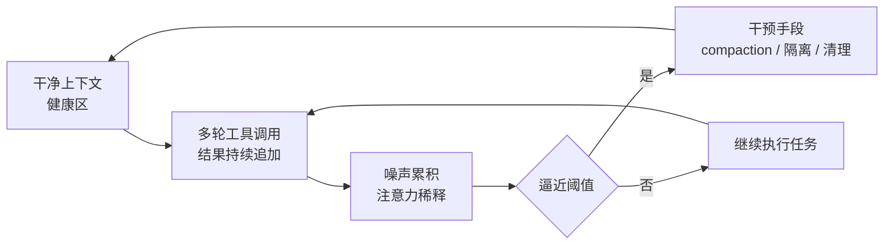

# 上下文工程实战：Context Window 的极限运营

## 从 Prompt Engineering 到 Context Engineering

2023 年我们谈 prompt engineering：怎么把一句话措辞改得更有效。2024 年谈 RAG：怎么把检索到的文档拼进 prompt。到了 agent 时代，问题升级了——模型面对的不再是"一条 prompt"，而是一个持续增长、多来源混合、随时可能爆炸的**上下文流**：系统指令常驻、几十个工具 schema 常驻、CLAUDE.md 常驻，然后每一轮对话、每一次工具调用都在往里追加内容。

范式随之迁移。Anthropic 在《Effective context engineering for AI agents》一文中给出的定义很精准：上下文工程是为系统每一步**精选恰当的信息子集**的艺术与科学。注意两个关键词："每一步"——它是一个动态过程而非一次性拼装；"恰当的子集"——不是越多越好，而是要精挑。

这和传统软件里的内存管理惊人地相似。上下文窗口就是你的内存条：容量有限、访问有代价（token 成本与延迟）、放太多垃圾会拖慢一切。上下文工程师的工作，本质上是在给 LLM 做极限的内存运营。

## 上下文的四块构成，以及它们各自怎么膨胀的

一个典型编码 agent 的上下文由四部分组成：

**1. 系统指令。** 行为规则、输出格式、安全约束。它的问题在于**只增不减**：每次发现模型某个行为不对，最省事的方案就是往系统提示里加一条规则。一年下来几千 token 的系统提示很常见。

**2. 工具定义。** 每个 MCP server 动辄注册十几个工具，每个工具的 schema（名称、描述、参数说明）几百上千 token。接上 GitHub、Slack、数据库三套 MCP 后，仅工具定义就可能占掉两三万 token——**在任何一次推理开始之前**，预算已经被吃掉一大块。工具数量还会反向影响选择准确率（工具超过一定数量后，模型选错的概率明显上升），这是双重惩罚。

**3. 记忆。** CLAUDE.md、用户偏好、历史会话的沉淀。设计良好的记忆是分层的、按需加载的；设计不良的记忆是一个无限增长的 README。

**4. 实时工作上下文。** 对话历史 + 工具调用与结果。这是膨胀最快的一块：一次文件读取几万 token，一次失败的搜索几千 token，几轮下来窗口见底。

前三块是"固定开销"，第四块是"动态开销"。上下文工程的所有策略，都是围绕"压缩固定开销、控制动态开销"展开的。

## Context Rot：为什么塞得越多，模型越笨

很多人有一个直觉错误：上下文窗口 200K，那就尽量多放信息，反正"放进去模型总能看到"。实际情况相反——**塞得越多，模型对每条信息的注意力越稀薄**。

这个现象被称为 context rot（上下文腐烂）。机制上可以这样理解：注意力是软性的，模型要在所有 token 之间分配"注意力预算"。上下文从 1 万 token 涨到 10 万，模型要在 10 倍的干扰中定位和组合信息，检索精度、指令遵循度、推理质量都会退化。长上下文基准测试里"大海捞针"成绩很好，但真实多步任务的表现衰减要严重得多——因为真实任务需要的不是单点检索，而是跨远距离的信息组合。

一个好用的心智模型：**把上下文当成血量条**。健康区间大概是窗口的前一半；超过某个阈值后模型开始"贫血"——变得健忘、机械、容易犯低级错误；打满时濒临崩溃。运营目标是让上下文长期维持在健康区，而不是挑战极限。



## 策略一：Just-in-Time Context——按需检索，拒绝预加载

传统 RAG 思维是"提前把可能相关的资料都塞进上下文"。agent 时代的正确姿势是反过来的：**上下文里只放指针，需要时用工具取**。

具体做法：

- 上下文里只保留文件路径、函数名、接口签名这些"地址"，用 Read/Grep 现场取货。Claude Code 不预读任何代码，模型先 Glob 找文件、再精确 Read 需要的部分，就是这个原则的体现。
- 大文件永远分页读，读完当前任务所需的那一段就走，不要"顺便把整个文件读了备用"。
- agentic search 优于一次性检索：模型可以多轮迭代搜索——第一轮 Grep 没找到就换关键词再来，这是传统 RAG 单次向量检索做不到的。

代价是延迟和工具调用次数增加，但换来的是每一轮推理面对的都是**小而相关**的上下文。用轮次换质量，在 agent 场景里几乎总是划算的。

## 策略二：Compaction——对话的垃圾回收

上下文逼近阈值时，最有效的干预是 compaction：把历史对话交给模型做一次结构化摘要，用摘要替换原始内容，会话继续。

两个关键决策点：

**什么时候触发？** 不要等打满。Claude Code 的实践是在接近窗口上限约 92% 时自动触发。更主动的做法是在任务的自然断点（完成一个子任务、通过一轮测试）主动 compact，因为这时信息结构最完整，摘要质量最高。

**摘要保留什么？** 这是 compaction 成败的核心。好的保留结构大致是：

```text
1. 任务目标与当前进度        # 使命不能丢
2. 关键决策及其理由          # 为什么选方案 A 不选 B
3. 涉及的文件路径与函数名    # 工作现场坐标
4. 未解决的问题与待办        # 下一步的起点
5. 用户明确表达过的偏好约束  # 边界条件
```

而对话中的寒暄、失败的尝试过程、中间搜索结果，都可以丢弃——注意"失败的尝试"要丢弃但**结论要留**："X 方案会导致循环导入，已放弃"这一句话，是几万 token 试错换来的，必须浓缩保留。

Compaction 是有损压缩，必然丢细节。工程上的补救是：**在 compact 前把不可再生的关键状态写入外部文件**（见策略三），摘要只是兜底，文件才是真相。

## 策略三：结构化笔记——NOTES.md 模式

Claude Code 官方博客推荐过一个朴素而有效的模式：让 agent 在长任务开始时创建一个 `NOTES.md`（或类似的临时文件），持续写入关键状态；每完成一个阶段就更新它。这样即使 compaction 丢失了对话细节，agent 重新读一下笔记文件就能恢复工作现场。

这个模式可以推广为三层记忆体系：

```text
工作记忆  -> NOTES.md 等临时文件，记录当前任务的现场状态
短期记忆  -> 会话内的 compaction 摘要，跨阶段保活
长期记忆  -> CLAUDE.md / memory 目录，跨会话沉淀
```

要点是**结构化**：笔记要按固定 schema 写（目标/决策/文件/待办），而不是自由日记。结构化内容在恢复时可以被精确定位读取——只需要"待办"一节时，Grep 一下就够，不必整篇重读。

## 策略四：Subagent 隔离——让脏活死在子上下文里

subagent 是上下文工程的"物理隔离"手段：主 agent 派生一个子 agent 去干会产生大量中间输出的活（全库搜索、读十几个文件做调研、跑批量验证），子 agent 在自己独立的上下文里消化所有噪声，**只把几百 token 的结论回传主上下文**。

一个直观的算术：主 agent 自己做一次全库调研，中间结果约 5 万 token 进主上下文；派 subagent 做，主上下文只增加约 500 token 的结论摘要。差距 100 倍，而且这些中间噪声如果留在主上下文，之后每一轮推理都要背着它们跑。

适用判断很简单：**这个活动的主产物是结论还是细节？** 要结论的（"这个 bug 在哪个模块"）适合外包；要细节的（"编辑这个函数"）必须留在主上下文亲手做。把 Edit 这类需要精确上下文的操作外包给 subagent，等于让一个没看过现场的人写代码，效果会很差。

## 一个长任务的上下文预算示例

假设 200K 窗口跑一个"给支付模块加重试机制"的重构任务，预算可以这样分配：

```text
固定开销（约 25K）：
  系统提示              4K
  工具 schema（20 个）  12K
  CLAUDE.md（分层后）    6K
  少量用户偏好           3K

动态开销（约 90K，健康区内滚动使用）：
  任务规划与 todo        3K
  定位阶段（Grep/Glob）  10K
  精读相关代码（3-4 个文件分页读） 30K
  修改与验证（Edit + 跑测试）      25K
  失败重试余量           10K
  记录 NOTES.md 开销      2K
  缓冲余量               10K

剩余约 85K 为安全余量，接近阈值则触发 compaction 后继续。
```

可以算一笔账：如果不做任何运营，把 5 个相关文件全文（约 100K）一次性塞进上下文，加上固定开销，初始状态就已经吃掉 125K，再跑两轮测试就触发 compaction——整个会话将在低质量上下文里挣扎。**预算思维决定了任务是顺畅推进还是一路救火。**

## 常见的上下文反模式

最后收拢一批我在真实项目里反复看到的错误做法：

**1. 把整个文件塞进上下文。"保险起见全部读进来"。** 一个 3000 行的文件约 6 万 token，塞进去后模型的注意力被无关代码稀释，反而更容易漏掉真正相关的几行。正确做法：先看结构（Grep 函数签名），再分页精读目标区域。

**2. 工具结果不截断。** 一条 `cat app.log` 吐回 50 万 token，一条失控的搜索打穿窗口。所有工具输出必须设上限，超长结果要么截断、要么落盘成文件让 agent 按需读取。

**3. 多轮累积噪声。** 失败的尝试、重复的搜索、过时的代码片段全部留在历史里，从不清理。旧版本代码片段尤其危险——模型可能把它当成当前事实继续引用。该 compact 就 compact，该隔离就隔离。

**4. 把记忆当仓库。** CLAUDE.md 写成千行的百科全书，每轮全量注入。记忆应该是"指针 + 索引"，大块知识放文件里按需读。

**5. 工具无限注册。** MCP server 接了七八套，工具 schema 常驻 3 万 token，模型选择工具的准确率同步下滑。砍到当前任务真正需要的十来个。

## 结语

上下文工程说到底是一种**稀缺资源运营**的功夫：窗口是内存，注意力是 CPU 时间片，每一轮推理都是一次资源分配决策。prompt engineering 关注"怎么说"，context engineering 关注"此刻模型应该看见什么"——后者才是 agent 系统里真正决定成败的那一层。当你发现自家 agent 越跑越笨，别急着换模型，先看看它的上下文里都堆了些什么。
