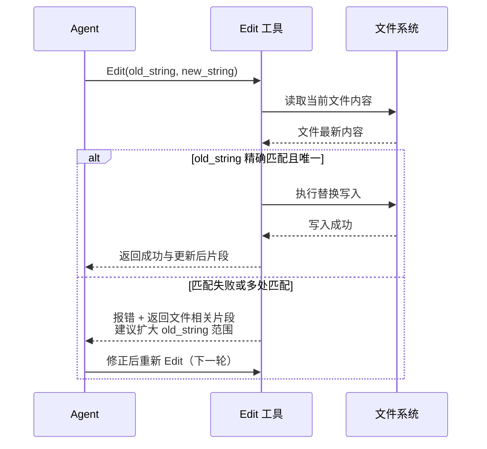

# 工具设计的艺术：写给 Agent 的 API 与写给人的 API 有什么不同

## 工具是 Agent 的感官和四肢

一个 agent 能做什么事，不取决于它"知道"什么，而取决于它**能通过工具触达什么、触达得有多精确**。模型再强，没有好工具就像一个天才被绑住手脚关在黑屋子里；而一组设计糟糕的工具，会让强模型表现出弱模型才有的愚蠢——选错工具、传错参数、在报错面前原地打转。

这就是本文的核心论点：**在 agent 系统中，工具不是功能的附属品，而是能力的天花板。** 同一个模型，接上两套不同质量的工具，表现差距可以大到让人怀疑是换了模型。所以"为 agent 设计工具"是一门独立的手艺，值得像当年"RESTful API 设计"那样被认真对待。

## 人和 Agent 消费 API 的方式完全不同

先想清楚一个根本差异：你的 API 有两类消费者，而他们的"调试手段"天差地别。

**人类开发者**拿到你的 API：读文档、看示例、跑一下、看报错、搜 Stack Overflow、改了再试。人有常识兜底，能容忍含糊的命名和稀烂的报错，试错成本是几分钟。

**Agent** 消费你的工具：它能看到的只有工具的 name、description 和参数 schema——这是它理解工具的**全部**。它没有文档站可逛，没有搜索引擎可问。一次调用失败意味着什么？浪费一整轮推理（几秒到几十秒的延迟 + 一次 API 计费 + 上下文里多一条错误记录），然后它只能依据报错文本盲目重试。

三个直接的推论：

1. **工具描述就是 agent 的唯一文档**，必须独立成篇、自包含，不能假设"开发者会去看 README"；
2. **一次失败的成本极高**，所以工具的报错必须教 agent 下一步怎么改，而不是汇报错误本身；
3. **工具行为的可预测性大于灵活性**，agent 无法通过"试一试"来理解黑盒行为。

## 工具描述怎么写：把"何时用/何时不用"写清楚

Anthropic 在《Writing effective tools for agents》中给出过核心建议，其中最有分量的一条是：**不要只描述工具是什么，要描述什么时候该用、什么时候不该用。**

反面例子（很常见）：

```text
search_docs: 搜索文档库。
```

正面例子（Claude Code 风格）：

```text
Grep: 基于 ripgrep 的内容搜索工具。
  - 支持完整的正则表达式语法
  - 输出为 file:line:content 格式，带上下文行
  使用时机：当你需要按内容/模式查找代码时（函数定义、字符串常量等）
  不要用于：打开文件看内容（用 Read）；按文件名查找（用 Glob）
  注意：单次输出超过 100 行会被截断，请用更精确的正则缩小范围
```

区别在哪？后者给了模型一个**决策框架**。agent 面对的任务是"在十几个工具里为一个意图选一个"，"何时用/何时不用"恰好就是这个决策的边界条件。特别是相近工具之间（Grep vs Glob、Read vs Bash cat、Edit vs Write），明确写出互斥边界能消除大部分误选。

其他几条描述规范：

- **参数命名自解释**：`file_path` 优于 `path`，`old_string` 优于 `s1`。agent 是靠名字理解语义的，缩写省下的 token 远抵不上误用的成本；
- **在描述里写死约束**：比如"路径必须为绝对路径""单次最多返回 50 条"，不要指望运行时才报错；
- **写清返回值结构**："返回匹配行数组，每项含 path/line/content 三字段"——agent 要基于返回值决定下一步，返回值结构必须先验可知。

## 数量的诅咒：工具越多，选择越差

还有一个容易被忽视的维度：**工具总数影响选择准确率**。多项研究和实践观察都指向同一个结论：候选工具超过一定数量（大致在 15-20 个量级）后，agent 的选择准确率开始明显下滑——描述之间的语义重叠增加，模型在相近候选间摇摆。

这对 MCP 时代的我们是个提醒：接入三四个 MCP server，工具轻松破 50 个，每一轮推理前全部 schema 常驻上下文。解法有两类：

- **做减法**：砍掉重复功能的工具，把高频的参数组合固化成独立工具（如 `search_code` 取代 `search` + `type=code`）；
- **动态注入**：按任务阶段或按用户开关加载工具子集，而不是全量常驻。

工具设计的第一性原理是 token 经济学：**schema 常驻上下文，每个工具每次推理都在付费。** 一个几乎不会被用到的大而全工具，是纯粹的负资产。

## 错误信息设计：报错要可行动

给人用的 API，报错追求"信息完整"——stack trace、错误码、内部状态一应俱全。给 agent 用的工具，报错追求**可行动（actionable）**：看完这条报错，agent 应该明确知道下一步怎么改。

对比一下：

```text
// 差：裸报错，agent 只能瞎猜重试
Error: ENOENT

// 差：信息多但没给方向
Error: file not found: src/api/handler.ts

// 好：告诉 agent 下一步
Error: file not found: src/api/handler.ts
当前目录下相近文件: src/api/handlers.ts, src/api/handler_v2.ts
请确认目标路径后重试，或先用 Glob 搜索。
```

第三种报错的关键差别：它把"人类调试时会做的联想"预置进了错误信息里。类似的设计还有很多：

- 编辑失败时返回"当前文件最新内容的相关片段"，而不是一句"old_string 不匹配"——agent 看到片段就知道该按什么改；
- 参数校验失败时给出 schema 期望的格式示例，而不是只说"参数非法"；
- 幂等冲突时返回现有资源的状态，让 agent 可以基于现状做增量决策。

一条原则：**把每次报错当成一次"教学时机"，而不是一次"事务终止"。** agent 没有老师，报错就是它唯一的老师。

## 粒度的权衡：合并琐碎工具 vs 拆分大工具

工具该做多粗还是做多细？两边都有陷阱。

**太琐碎的问题**：一个"create_user / update_user / delete_user / get_user / list_user"式的 REST 风格工具家族，会撑大 schema 开销、增加选择难度，而且常见操作序列（创建后立刻授权）被迫拆成多次调用、多次失败面。

**太粗粒度的问题**：一个万能 `manage_project(action, ...)` 工具，描述写不清楚，参数组合爆炸，行为不可预测，agent 传错参数的概率飙升，出错后的诊断也困难。

实践中的收敛点：

1. **按"心智模型完整性"切分**：一个工具对应 agent 的一项完整意图。`create_issue` 比 `issue(action="create")` 好，但 `create_issue_and_assign` 就是过度合并了两个意图；
2. **高频参数组合可以固化**：如果 agent 总是 A 之后紧跟 B，且 A+B 作为一个原子事务更安全（如"创建文件并写入内容"就该是一个 Write，而不是 create_file + write_content 两步）；
3. **用参数分化代替工具增殖**：`read_file(offset, limit)` 一个工具覆盖整读和分页，好于 `read_file` + `read_file_head` 两个。

Claude Code 的工具集是良好示范：十来个工具，每个对应一个清晰意图，参数设计覆盖同一意图下的常见变体。

## 幂等性与并发安全

Agent 和人类用户有个行为差异：**agent 会重试，而且重试得很快、很机械。** 你的工具如果没有幂等设计，一次网络抖动后的自动重试就会创建两个重复的工单、发两条重复的消息。

设计要求：

- **写操作尽量幂等**：支持 client 提供的 `request_id` / 幂等键，同一键重复调用返回同一结果而非重复执行；
- **读操作绝对无副作用**：agent 常常"先读确认再写"，读操作若有隐藏副作用（如标记已读、扣积分）会引发诡异 bug；
- **明确并发语义**：两个 subagent 并行编辑同一文件是真实会发生的场景。要么加锁并在冲突时报"可行动"错误（"文件正被其他任务编辑，请稍后重试或先读取最新版本"），要么用乐观锁（版本号/内容哈希校验，Claude Code 的 Edit 就内嵌了这一点）；
- **高危操作要求显式确认**：删除、发布、付款类操作设计成两段式（dry-run 返回影响面，确认参数后执行），agent 可以先看再动手。

## 真实案例：为什么 Edit 的 old_string/new_string 优于行号 patch

早期很多 coding agent 的编辑工具长这样：`patch(file, line_start, line_end, new_content)`。直觉上很合理——精确、省 token。但实际使用中模型频繁翻车：它数错行号。LLM 对"这是第几行"的感知极不可靠，尤其文件在前面几轮已被修改过之后，行号早已漂移。

Claude Code 的 Edit 改用了 `old_string/new_string` 精确替换：

```text
Edit(file_path, old_string, new_string)
  old_string: 文件中将被替换的原文，必须与文件内容逐字符一致（含缩进）
  new_string: 替换后的新文本
  约束：old_string 必须在文件中唯一；不唯一时返回报错并建议扩大上下文范围
```

这个设计的优越之处值得逐条拆：

一次典型的编辑失败与自愈流程是这样的：



逐条拆解其优越性：

1. **用模型的长板规避短板**。复制原文是语言模型的强项（逐 token 已在上下文里），数行号是弱项。设计工具时应该让模型用长板干活；
2. **天然防错**。old_string 匹配失败说明模型对文件现状的理解有误——这恰好是最该被拦住的错误。匹配成功则意味着"模型看到的世界"和"真实世界"是一致的，编辑是建立在正确认知上的。行号 patch 则没有这层校验：行号错了照样改，改的就是错的地方；
3. **失败即教学**。匹配失败时返回文件当前的相关片段，模型立刻自我修正，通常下一轮就成功；
4. **内容寻址天然抗漂移**。多次编辑之间行号全在变，但内容锚点不受影响。

反面教材是"唯一性"这个约束暴露的问题：文件里有多处相同片段时 Edit 会拒绝执行。但注意它的报错设计——提示"把更多上下文包进 old_string 使其唯一"，这就把失败转化成了下一步的指引，正好呼应前文的可行动报错原则。

## 给工具设计者的 Checklist

为 agent 设计工具时，逐项过一遍：

```text
理解成本
  [ ] name 是动词短语，自解释，无缩写歧义
  [ ] description 独立自包含，不依赖外部文档
  [ ] 写明了"何时用"和"何时不用"，与相近工具划清边界
  [ ] 参数名自解释，必填项最少化，描述里带格式示例
  [ ] 返回值结构在描述中先验可知

行为设计
  [ ] 报错可行动：包含原因 + 下一步建议（相近资源、正确格式示例）
  [ ] 读操作无副作用，写操作幂等（支持幂等键）
  [ ] 并发冲突有明确语义和可行动的报错
  [ ] 高危操作支持 dry-run / 两段式确认
  [ ] 长输出自动截断或落盘，绝不打穿上下文

成本与规模
  [ ] schema 紧凑：无冗余字段，描述控制在几百 token 内
  [ ] 工具总数有意识控制（接近 20 个时做合并或动态加载）
  [ ] 不存在"几乎不会被调用"的大而全工具
  [ ] 参数用枚举/格式约束收窄，减少模型自由发挥的空间

可演化性
  [ ] 工具行为变化时，description 同步更新（agent 的"文档"就是 schema）
  [ ] 返回值结构保持向后兼容，新增字段只增不改语义
```

## 结语

回到开头的比喻：工具是 agent 的感官和四肢。设计感官时问"它能不能可靠地感知"，设计四肢时问"它能不能精确地行动，失败了知不知道怎么纠正"。判断一套工具好不好，有个简单的测试方法：把工具描述丢给一个从没见过你系统的 agent，看它能否在一次会话内、零人工干预地正确完成任务。能，说明你的工具"会说话"；不能，看它卡在哪一步——那一步就是你描述或报错的缺陷所在。为 agent 设计工具，本质上是把对人类开发者的所有体贴（好文档、好报错、好默认值），压缩进几百 token 的 schema 里，再乘以它在整个系统里被调用一万次的频次。
