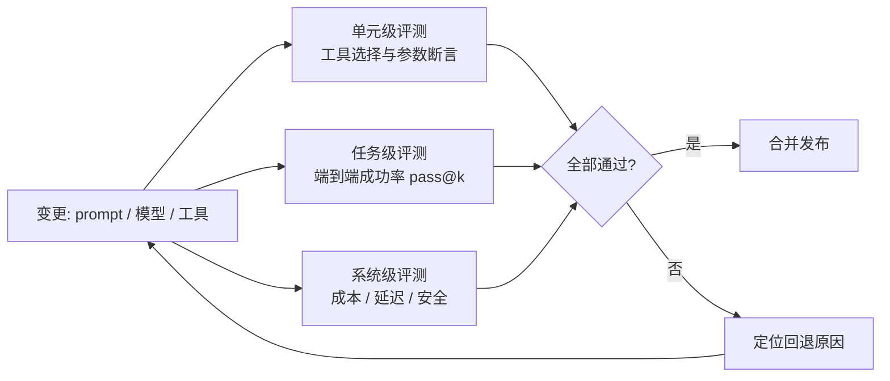

# Agent 评测（Evals）实战：如何科学衡量一个智能体

## "感觉变好了"为什么不可靠

改了一版 system prompt，翻了几十个对话记录，感觉 Agent 回答更靠谱了——这是几乎所有 Agent 团队都经历过的决策时刻。Manus 团队在一篇广为流传的博客里把这个现象点破了：**LLM 输出是非确定性的，人类对非确定性系统的直觉判断天然失准**，你不看数据，你的大脑会自动挑选支持你直觉的样本。

这不是态度问题，是数学问题。假设某任务的真实成功率为 60%，你抽查 10 个对话看到 7 次成功，这和 60% 的假设完全相容（二项分布下 P(X>=7) 约 0.18）；你今天运气好看到 7 成功、昨天运气差看到 4 成功，两天的"感受"能差出 30 个百分点，而背后什么都没变。反过来，如果你在 5 个用例上从 3 成变成 4 成，就宣称"提升 20%"，这几乎必然是噪声。

结论只有一个：**Agent 的每次能力判断都必须建立在足够样本量的重复实验上**。评测（evals）不是锦上添花的工程实践，而是 Agent 开发的方向盘——没有 evals，你甚至不知道自己今天是在前进还是在绕圈。

## 评测的三个层次

把"评测"一词拆开，Agent 场景下至少有三个层次，各自回答不同的问题，工具与指标完全不同。

### 单元级：单工具调用对不对

最低层评测的对象是**单次工具调用**：给定上下文，模型选对工具了吗？参数填对了吗？典型用例：

- 用户说"帮我把 src 目录下所有 ts 文件重命名为 tsx"，期望 Agent 调用 `Bash` 且命令正确，而不是对每个文件手动调用 30 次 `Write`；
- 读文件前是否先调用了正确的路径（而不是猜路径）；
- 结构化输出场景下 JSON 是否合法、枚举值是否在允许范围内。

这一层可以用传统单元测试的思路跑：固定输入、断言工具名与参数。它跑得快、定位准，适合在 prompt 或工具 schema 每次改动后全量执行，充当"冒烟测试"。

### 任务级：端到端能不能成

单元对不等于任务成。任务级评测的对象是**完整的多轮执行轨迹**：给 Agent 一个目标，让它自主执行到结束，判定最终结果是否达成。代表就是 SWE-bench：给一个真实 GitHub issue 和对应仓库，Agent 产出 patch，用仓库自带的测试用例判定 pass/fail——**判定标准客观、可自动执行**，这是任务级评测设计的黄金标准。

任务级的核心指标是**成功率**（pass rate），以及由它衍生的 pass@k、pass^k（下文详述）。设计自己的任务级 eval set 时，最重要的原则是"结果可判定"：要么有可运行的测试，要么有可校验的产物（文件 diff、结构化数据、确定性的文本匹配），尽量避免"人工看一眼"这种不可复现的判定。

### 系统级：变的到底是不是好事

前两层都只看"对不对"，系统级评测看**代价与风险**：

- **成本回归**：这次 prompt 改动让平均 token 消耗涨了 40%，成功率只涨 2 个点，划算吗？
- **延迟回归**：新增了一轮"先反思再执行"，P95 延迟翻倍；
- **安全回归**：新 prompt 是否让 Agent 更容易执行危险命令、更容易泄露上下文？沙箱拒绝率的变化也是指标。

很多"成功率提升"的改动，在系统级视角下是净亏损。成熟的团队会把成本、延迟、拒绝率与成功率放在同一个 dashboard 上，任何变更四项一起看。

## 构建自己的 eval set：从失败案例出发

通用 benchmark（SWE-bench、GAIA、WebArena）适合横向比较模型与产品定位，但**无法回答"我的用户遇到的坑，我的 Agent 处理得怎么样"**。自建 eval set 才是日常开发的主战场，而它的第一手素材来源是：真实失败案例。

### 从投诉到用例

流程是这样的：

1. **收集失败**：用户投诉、人工抽检发现的坏 case、客服记录、内部 dogfood 里的翻车记录，全部归档。每条记录尽量保留完整上下文（用户原始请求、Agent 的完整轨迹、当时的模型与 prompt 版本）。
2. **归因分类**：失败是因为工具选错？参数错？上下文缺失？还是任务本身超出当前能力？分类决定这条用例修复的希望大小。
3. **转化为测试用例**：把失败场景改写成 eval 条目——输入（含必要的初始环境，如仓库快照）、预期行为或预期产物、判定方法。注意**保留失败案例的真实分布**：如果 60% 的投诉来自长上下文多轮场景，eval set 里长上下文用例就该占 60%，而不是凭兴趣写成十个都像 demo 的短用例。
4. **定期再生产**：eval set 不是一次性的。每周把新失败案例转成用例，同时剔除被新能力覆盖后失去区分度的旧用例（但仍建议保留，用于回归）。

### 样本量：10-20 个是底线，不是目标

多少用例才够？给出一个可以拍脑袋使用的经验法则：**10-20 个用例是能看出信号的最低限度，50-100 个才能做较细粒度的对比**。

算一笔账就明白为什么。设成功率为 p，n 个用例的实验中，成功率估计的标准误是 `sqrt(p(1-p)/n)`。p=0.6、n=20 时标准误约 11 个百分点——你要在两个版本之间看到超出 ±11% 的差异，才勉强谈得上显著；n=5 时标准误约 22%，**任何"5 个用例提升 20%"的结论都没有统计意义**。这不是说小 eval set 没用——它至少能抓住"彻底坏了"级别的回归——而是要诚实地知道它的分辨率。

提高分辨率的另一个手段不是加用例数，而是**同一用例重复 N 次**（下节展开），两者按成本组合使用。

### eval set 工程化的基本要求

- **版本化**：eval set 进 git，每次修改有记录、可回滚，否则评测结果跨版本不可比；
- **可复现**：每条用例自带环境准备脚本（初始化沙箱、checkout 指定 commit、清理产物），做到"任何人任何机器跑出同样的轨迹"；
- **判定代码化**：judge 逻辑写成代码入库，同样受版本控制。

## LLM-as-judge：好用，但偏差必须管

很多任务没有客观判定标准（"回答是否有帮助"），只能请一个更强的 LLM 来当裁判。LLM-as-judge 实用且可规模化，但**裁判自身也有系统性偏差**，不处理就会把评测带偏。

### 三大偏差

**位置偏差（position bias）**：成对比较（A vs B，哪个更好）时，LLM 对选项顺序敏感，倾向于偏向某个位置（常见是先出现的那个）。同一个回答放 A 位和 B 位可能得到相反的判罚。

**长度偏差（verbosity bias）**：裁判偏爱更长、更面面俱到的回答——即使长的那份其实啰嗦、甚至包含冗余错误。对 Agent 场景尤其致命：Agent 输出天然冗长（工具调用轨迹、解释文字），长度偏差会系统性地奖励"话多"的版本。

**自我偏好（self-preference bias）**：如果裁判模型和被评模型同源（比如用 GPT-5 当裁判评 GPT-5 与 Claude 的输出），裁判会偏好自己家族的风格。用同一个模型评"新旧 prompt"时，这个偏差同样存在。

### 缓解手段

三条实践，成本不高，收益显著：

1. **成对比较 + 位置随机化**：不要让 judge 打绝对分（1-10 分的绝对打分跨版本漂移严重），而是让它做 A/B 成对比较；每次比较随机交换两个候选的位置，跑两次，两次结论一致才计票。这几乎消除位置偏差，同时把绝对分数的漂移问题一并解决。
2. **多 judge 投票**：用两三个不同家族的模型当裁判，多数决。单 judge 的风格偏差被稀释；成本允许时这是最有效的一招。
3. **校准人类锚点**：抽样一部分用例做人工评判，与 judge 结论对齐，计算一致率。一致率持续偏低说明 judge prompt 有问题或偏差未消除，需要修 judge 而不是信它。另可参考 MT-Bench 等论文中"与人类一致率"的报告方式，给 judge 结论一个可信度标注。

## 多轮重复、pass@k 与 pass^k

Agent 任务的方差远大于普通问答：同一个任务，模型可能这次走对了路径、下次卡在某个工具报错上。因此 Agent 评测必须显式处理重复实验。

**同用例跑 N 次**是基本操作：对每个用例跑 N 次（常见 5-10 次），以成功次数的比率作为该用例的成功率估计。N 的选择取决于方差：如果某用例成功率长期是 0 或 1，跑 3 次即可；如果是 0.5 附近的"摇摆用例"，它是版本对比的主要信息来源，值得多跑。样本预算有限时，优先给摇摆用例分配重复次数。

然后是两个容易混淆的指标，源自 OpenAI 人类评估论文（HumanEval）的定义，在 Agent 语境下含义有微妙但重要的差别：

- **pass@k**：每个任务**独立采样 k 次**，只要有一次成功就算过。它衡量"给 Agent k 次机会能否解决"，对应产品里"失败后自动重试"的体验。数学上，pass@k = 1 - C(n-c, k)/C(n, k)（n 次采样中 c 次成功的无偏估计）。
- **pass^k**：同一任务**连续执行 k 次，要求 k 次全部成功**。它衡量稳定性，对应"这个 Agent 能不能放进自动化流水线无人值守地跑"。pass^k 对方差极度敏感——一个平均成功率 90% 的 Agent，pass^5 只剩约 59%。

两者一个偏乐观、一个偏悲观，回答完全不同的产品问题。汇报评测结果时必须写清楚是哪一个，只报 pass@k 而产品实际是无人值守场景，是常见的自欺。

## 回归防御：任何变更都跑全量 eval

Agent 系统的组件耦合度远超传统软件：**模型、prompt、工具定义、工具实现、上下文组装策略，任何一处变更都可能波及全系统的行为**。换一个模型版本，之前调好的 few-shot 可能失效；改一个工具的参数描述，模型对另一个工具的调用习惯也可能变化。

所以回归纪律必须是一条硬规则：**模型、prompt、工具三者中任何一个变更，都触发全量 eval 流水线**。没有跑全量 eval 的变更不允许合入——把 eval 当成 CI 里的必过检查，而不是开发者心情好才跑的脚本。

配套的工程细节：

- **主记录（golden file）与告警**：每个版本的全量 eval 结果落库，与上一版本逐用例 diff；任何一个用例从"稳定通过"变成"稳定失败"都要人工确认原因，杜绝"整体成功率没掉但悄悄换了失败模式"的隐性回归。
- **快速与全量分层**：全量 eval 贵且慢，可以设一套 5 分钟内的快速子集（易失败的摇摆用例优先）在每次提交触发，完整全量在合并前与每日定时触发。
- **失败可回放**：记录每次评测运行的完整轨迹（prompt、工具调用、结果），失败用例能一键重放，这会把 eval 从"分数报表"升级为"调试工具"。

## 评测环境隔离与数据污染

最后是被讨论得最少、却最容易毁掉评测可信度的两个问题。

**数据污染（contamination）**：如果 eval 用例的内容已经在模型的训练数据里（SWE-bench 的 issue 不少是公开仓库的真实 issue，各家模型大概率见过），评测测的是记忆而不是能力。缓解手段：优先使用私有失败案例构建 eval set（天然无污染）；对公开 benchmark，关注其更新版本（SWE-bench Verified、LiveBench 类"滚动更新"榜单）；用例中的标识符、变量名可做改写以降低记忆命中。反过来也要注意**不要**故意用训练时点之后的全新数据做高难度评测，否则可能测出的是模型"瞎蒙能力"。

**评测环境隔离**：评测必须在受控沙箱内运行（这正是前一篇沙箱文章的价值所在）——网络按需白名单、文件系统隔离、每条用例独立环境。否则上一条用例留下的副作用会污染下一条（比如 Agent 发现了一个"作弊路径"写进了缓存，后续所有用例"成功"都是假象）。同时隔离保证安全：eval 中故意包含攻击性输入（注入用例、危险命令用例）时，绝不能在无隔离的开发机上跑。

## 工具链推荐

按团队投入程度分三档：

- **promptfoo**：轻量开源的 prompt/Agent 评测框架，YAML 声明用例，支持多 provider 对比、LLM-as-judge（内置成对比较）、断言式判定。适合起步阶段，半天就能接入 CI。
- **LangSmith（及 Langfuse 类平台）**：评测 + 轨迹追踪 + 数据集管理一体的商业平台，优点是轨迹可视化、失败分析体验好、与 LLM 应用框架集成顺滑；代价是数据出内网（Langfuse 可自部署）与供应商锁定。
- **自建 harness**：当评测需求长出团队特异性——私有判定逻辑、特殊环境准备、成本审计口径——自建就是必然。核心组件不过五件：用例存储（git 里的 YAML/JSON）、 runner（并发调度 + 沙箱调用）、judge（代码判定 + LLM 裁判）、结果库（带版本与 diff）、报告（dashboard）。自建的最大好处是评测逻辑与业务强绑定，长期维护成本反而更低。

起步建议：先用 promptfoo 把"全量回归"这条纪律立起来，等评测成为日常流程后，再按需迁移到平台或自建。

## 结语

Agent 工程与传统软件工程最深的分野在于：**它的行为是非确定的，而它的开发节奏又是极快的**。非确定要求统计判断，快节奏要求自动化护栏，两者共同指向同一件事——把 evals 建成开发流程的地基，而不是事后验证。从今天起把用户的每个投诉变成 eval 用例，把每次变更绑上全量回归，一个月后你会第一次真正"看见"自己的 Agent 在变好还是变坏。
