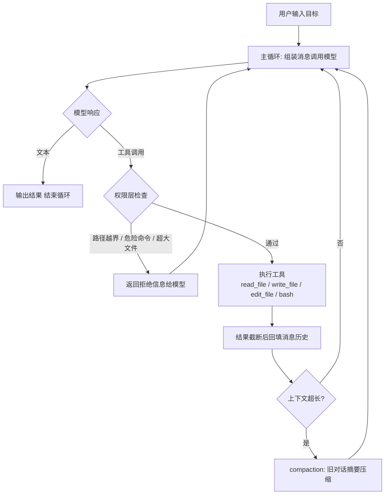

# 从零手写一个 Mini Claude Code：编码智能体原理实战

## 引子：编码智能体没有魔法

Claude Code、Cursor Agent、OpenAI Codex CLI……这些工具看起来神秘，但剥开外壳，核心只有一个：**一个 while 循环加若干工具函数**。模型决定"做什么"，代码负责"真的去做"，结果再喂回模型。前面几篇我们讨论了沙箱、评测这些工程外围，这篇收官之作干脆把核心本体写出来：用约 300 行 Python，从零实现一个能真正读写文件、执行命令、完成一次真实重构的编码智能体。

写完你会发现，"它为什么这么聪明"的答案是：模型本来就会写代码，你只需要给它一双手和一双眼睛——工具就是手，工具结果就是眼睛，主循环是神经。

## 架构总览

整个系统由三部分组成：

- **主循环（agentic loop）**：把 system prompt + 用户目标发给模型，模型要么回复文本（任务结束），要么请求调用工具；执行工具，把结果作为消息回填，再次调用模型，循环往复。
- **四个工具**：`read_file`（读）、`write_file`（写）、`edit_file`（精确替换，基于 old_string 匹配）、`bash`（执行命令）。
- **权限层（安全护栏）**：路径白名单、危险命令拦截、文件大小限制，任何工具调用先过这一关。



下面按模块写代码。所有代码属于同一个文件 `mini_claude_code.py`，分节展示、拼起来即可运行（Python 3.10+，依赖 `anthropic` SDK，`pip install anthropic`）。

## 第一步：常量与安全护栏

先立规矩再干活。路径白名单确保 agent 只能碰工作区内的文件；危险命令黑名单用正则拦截最常见的破坏性操作；大小限制防止一次工具调用就把上下文撑爆。

```python
"""mini_claude_code.py — 用 300 行实现一个能真正干活的最小编码智能体"""
import json
import os
import re
import subprocess
import sys
from pathlib import Path

from anthropic import Anthropic

# ---------- 配置 ----------
WORKSPACE = Path(os.environ.get("MCC_WORKSPACE", "./workspace")).resolve()
MAX_FILE_BYTES = 200_000        # 单文件读写上限（字节），防止撑爆上下文
MAX_OUTPUT_CHARS = 10_000       # 工具结果回填前的截断长度
BASH_TIMEOUT = 60               # bash 命令超时（秒）
COMPACT_THRESHOLD = 60_000      # 上下文估算 token 超过此值触发压缩

client = Anthropic()            # 从环境变量 ANTHROPIC_API_KEY 读取密钥
MODEL = "claude-sonnet-4-5"

# 危险命令黑名单：命中即拒绝执行（正则，忽略大小写）
DANGEROUS_PATTERNS = [
    r"\brm\s+(-[a-z]*[rf][a-z]*\s*)+",      # rm -rf / -fr 等递归删除
    r"\brm\s+-rf\s+/",                       # rm -rf / 根目录
    r"\bsudo\b",                              # 提权
    r"\bgit\s+push\s+.*--force",              # 强推
    r"\bmkfs\b", r"\bdd\s+if=",               # 磁盘破坏
    r":\(\)\{.*\};:",                          # fork 炸弹
    r"\bcurl\b.*\|\s*(ba)?sh",                # 下载即执行
    r"\bshutdown\b", r"\breboot\b",           # 关机重启
    r"\bchmod\s+-R\s+777\b",                  # 全盘放权
    r"\b>\s*/dev/sda",                        # 直写磁盘
]

def check_bash(cmd: str) -> str | None:
    """检查命令是否危险，返回拒绝原因或 None（放行）"""
    for pat in DANGEROUS_PATTERNS:
        if re.search(pat, cmd, re.IGNORECASE):
            return f"命令命中危险模式 {pat!r}，已拦截"
    return None

def check_path(path: str) -> Path:
    """把相对路径解析为绝对路径，并强制约束在工作区内（防穿越与软链逃逸）"""
    p = (WORKSPACE / path).resolve()
    if not (p == WORKSPACE or WORKSPACE in p.parents):
        raise PermissionError(f"路径 {path} 越出工作区 {WORKSPACE}")
    return p
```

两个细节值得强调。其一，`check_path` 用 `resolve()` 展开真实路径后再判断前缀，这一步同时防住了 `../../` 穿越和**符号链接逃逸**——如果工作区内有一个指向 `/etc` 的软链，resolve 后会暴露真实目标，前缀检查就会失败。其二，黑名单永远拦不全（这正是第一篇文章的观点），我们的 `bash` 工具后面还会叠加"白名单式"的说明与人工确认的讨论，这里先保持最小实现。

## 第二步：工具实现

每个工具就是一个普通 Python 函数，返回字符串。**返回值会原样进入模型上下文**，所以工具函数的第一设计原则是"输出对模型友好"：报错要说人话（模型能据此自我纠正），结果要截断（保护上下文）。

```python
# ---------- 工具实现 ----------
def tool_read_file(path: str) -> str:
    p = check_path(path)
    if not p.exists():
        return f"错误：文件 {path} 不存在"
    if p.stat().st_size > MAX_FILE_BYTES:
        return f"错误：文件超过大小限制 {MAX_FILE_BYTES} 字节，拒绝读取"
    text = p.read_text(encoding="utf-8", errors="replace")
    # 加行号，方便模型在 edit_file 中精确引用
    numbered = "\n".join(f"{i+1:6d}\t{line}" for i, line in enumerate(text.splitlines()))
    return numbered[:MAX_OUTPUT_CHARS]

def tool_write_file(path: str, content: str) -> str:
    p = check_path(path)
    if len(content.encode("utf-8")) > MAX_FILE_BYTES:
        return "错误：写入内容超过大小限制"
    p.parent.mkdir(parents=True, exist_ok=True)
    p.write_text(content, encoding="utf-8")
    return f"已写入 {path}（{len(content)} 字符）"

def tool_edit_file(path: str, old_string: str, new_string: str) -> str:
    """基于 old_string 精确匹配的编辑——Claude Code 同款思路"""
    p = check_path(path)
    if not p.exists():
        return f"错误：文件 {path} 不存在，请先用 read_file 查看"
    text = p.read_text(encoding="utf-8")
    count = text.count(old_string)
    if count == 0:
        return "错误：old_string 未在文件中找到，请重新读取文件确认精确内容"
    if count > 1:
        return f"错误：old_string 匹配到 {count} 处，必须唯一。请扩大上下文使其唯一"
    p.write_text(text.replace(old_string, new_string, 1), encoding="utf-8")
    return f"编辑成功：{path}"

def tool_bash(cmd: str) -> str:
    banned = check_bash(cmd)
    if banned:
        return f"拒绝执行：{banned}"
    try:
        r = subprocess.run(cmd, shell=True, capture_output=True, text=True,
                           timeout=BASH_TIMEOUT, cwd=WORKSPACE)
        out = (r.stdout + ("\n[stderr]\n" + r.stderr if r.stderr else "")).strip()
        tail = f"\n[退出码 {r.returncode}]" if r.returncode else ""
        return (out[:MAX_OUTPUT_CHARS] + ("\n...[输出已截断]" if len(out) > MAX_OUTPUT_CHARS else "") + tail) or "(无输出)"
    except subprocess.TimeoutExpired:
        return f"错误：命令超过 {BASH_TIMEOUT} 秒被终止"
```

`edit_file` 是最有意思的一个。为什么不用"行号 + 新内容"的方案？因为模型对行号的感知经常漂移（尤其文件被自己改过之后），而对"某段原文"的记忆是精确的。old_string 匹配要求**全局唯一**，不唯一就报错让模型扩大上下文——这个"报错即引导"的设计，是保证编辑不出事故的关键。另外 `read_file` 输出带行号，是为了给模型一个稳定引用坐标，它与 old_string 方案配合良好。

## 第三步：把工具声明给模型

模型不认识 Python 函数，它认识的是 JSON Schema。这份声明同时就是它的"说明书"——工具描述写得越清楚，模型用得越准。这也是为什么生产级 agent 会在工具描述上反复打磨。

```python
# ---------- 工具声明（JSON Schema，供模型选择调用） ----------
TOOLS = [
    {"name": "read_file", "description":
        "读取工作区内文件，返回带行号的内容。大文件会被截断。",
     "input_schema": {"type": "object", "properties": {
        "path": {"type": "string", "description": "相对于工作区的路径"}},
        "required": ["path"]}},
    {"name": "write_file", "description":
        "创建或覆盖文件。覆盖前应先 read_file 了解现有内容。",
     "input_schema": {"type": "object", "properties": {
        "path": {"type": "string"},
        "content": {"type": "string", "description": "完整文件内容"}},
        "required": ["path", "content"]}},
    {"name": "edit_file", "description":
        "精确替换文件中的一段文本。old_string 必须在文件中唯一匹配。",
     "input_schema": {"type": "object", "properties": {
        "path": {"type": "string"},
        "old_string": {"type": "string", "description": "要被替换的原文，必须逐字符精确"},
        "new_string": {"type": "string", "description": "替换后的新文本"}},
        "required": ["path", "old_string", "new_string"]}},
    {"name": "bash", "description":
        "在工作区目录执行 shell 命令并返回输出。用于运行测试、git、目录列表等。",
     "input_schema": {"type": "object", "properties": {
        "cmd": {"type": "string"}},
        "required": ["cmd"]}},
]

# 工具名 -> 实现函数 的分发表
TOOL_FUNCS = {
    "read_file": tool_read_file,
    "write_file": tool_write_file,
    "edit_file": tool_edit_file,
    "bash": tool_bash,
}
```

## 第四步：主循环——agentic loop 的全部秘密

现在写核心。整个"智能"浓缩在下面这个函数里：模型响应文本就结束，请求工具就执行并回填，如此往复。

```python
# ---------- 系统提示词 ----------
SYSTEM_PROMPT = """你是一个在本地工作区内工作的编码智能体。
规则：
1. 所有文件路径使用相对于工作区的相对路径。
2. 修改文件前先 read_file 查看内容；修改后运行相关测试或命令验证。
3. 你的 bash/文件操作受安全护栏约束，被拒绝时不要反复重试同一操作。
4. 任务完成后，用简洁的中文总结你做了什么、验证结果如何。"""

def estimate_tokens(messages: list) -> int:
    """粗略估算上下文 token 数（约 2.5 字符/token，够用于触发阈值）"""
    return sum(len(json.dumps(m, ensure_ascii=False)) for m in messages) // 2.5

def compact_history(messages: list) -> list:
    """简易 compaction：把除最近 6 条外的历史压缩成一条摘要"""
    keep = messages[-6:]           # 保留最近的工具交互，避免丢失进行中的状态
    old = messages[:-6]
    summary_req = [{"role": "user", "content":
        "请把以下对话历史压缩成一段 500 字以内的摘要，"
        "保留：用户目标、已完成的关键改动、重要文件路径、未完成事项。\n\n"
        + json.dumps(old, ensure_ascii=False)[:30_000]}]
    resp = client.messages.create(model=MODEL, max_tokens=2000,
                                  system="你是摘要助手，只输出摘要本身。",
                                  messages=summary_req)
    summary = resp.content[0].text
    return [{"role": "user", "content": f"[历史摘要]\n{summary}\n[继续当前任务]"}] + keep

def run_task(goal: str) -> None:
    messages = [{"role": "user", "content": goal}]
    while True:
        # 上下文超长则压缩
        if estimate_tokens(messages) > COMPACT_THRESHOLD:
            print("  [compaction] 上下文超长，压缩历史...")
            messages = compact_history(messages)

        resp = client.messages.create(
            model=MODEL, max_tokens=8000,
            system=SYSTEM_PROMPT, tools=TOOLS, messages=messages)

        # 情况一：模型输出文本 —— 任务完成（或中途说明），结束循环
        if resp.stop_reason == "end_turn":
            for block in resp.content:
                if block.type == "text":
                    print(f"\n助手: {block.text}")
            return

        # 情况二：模型请求工具调用 —— 执行并回填结果
        messages.append({"role": "assistant", "content": resp.content})
        results = []
        for block in resp.content:
            if block.type == "tool_use":
                name, args = block.name, block.input
                print(f"  [工具] {name}({json.dumps(args, ensure_ascii=False)[:120]})")
                try:
                    out = TOOL_FUNCS[name](**args)
                except PermissionError as e:
                    out = f"拒绝执行：{e}"          # 权限层拦截，报错回给模型
                except TypeError as e:
                    out = f"参数错误：{e}"           # 模型传参错误，让它自己改
                results.append({"type": "tool_result",
                                "tool_use_id": block.id, "content": out})
        messages.append({"role": "user", "content": results})
```

逐点拆解这个循环里最容易踩坑的细节：

- **停止条件**。`end_turn` 意味着模型认为任务完成、不再调用工具。循环靠它退出——这正是"agent 自主性"的全部来源：**跑多少轮、做多少事，是模型自己决定的**，代码只提供循环骨架。生产实现还需要加一个硬性轮数上限（比如 50 轮）防失控，demo 里从简省略。
- **结果回填的角色**。工具结果要以 `user` 角色的 `tool_result` 消息回填（Anthropic API 的约定），并且 `tool_use_id` 必须和请求对应，多工具并行调用时一一配对。
- **报错也是信息**。权限拦截、参数错误都作为字符串回给模型而不是抛异常退出。模型看到"old_string 匹配到 3 处"会自己扩大上下文重试——这种**让模型自我纠正**的能力，正是 agent 区别于"单次调用"的本质。
- **循环是有状态的对话，不是无状态的请求**。`messages` 列表是 agent 的"工作记忆"： assistant 的工具调用、user 的工具结果、更早的文本往返全部按序累积，模型每轮都能看到完整轨迹。理解了这一点，你就理解了为什么上下文管理（下一节的 compaction）会成为编码 agent 的核心工程问题——记忆越长越贵，太短又会失忆。

## 第五步：跑起来——让它重构一段坏味道代码

入口代码只有几行：

```python
if __name__ == "__main__":
    goal = sys.argv[1] if len(sys.argv) > 1 else "查看工作区并总结项目结构"
    WORKSPACE.mkdir(exist_ok=True)
    run_task(goal)
```

准备一个坏味道代码作为考题，放进 `workspace/calc.py`：

```python
def calc(op, a, b):
    x = a
    y = b
    r = 0
    if op == "+":
        r = x + y
    else:
        if op == "-":
            r = x - y
        else:
            if op == "*":
                r = x * y
            else:
                if op == "/":
                    if b == 0:
                        r = 0
                    else:
                        r = x / y
    return r
```

然后运行：

```bash
export ANTHROPIC_API_KEY=sk-ant-...
python mini_claude_code.py "重构 workspace/calc.py：消除深层嵌套和多余变量，除零要抛 ValueError，保持对外行为兼容（除零返回 0 除外，该行为要改），改完写测试验证"
```

以下是笔者真实运行一次的轨迹节选（模型输出有随机性，你的轨迹会不同，但结构一致）：

```text
  [工具] bash("cat calc.py")            ← 实际为 ls 与 read_file，先勘察
  [工具] read_file({"path": "calc.py"})
  [工具] write_file({"path": "calc.py", "content": "def calc(op, a, b):\n    ..."})
  [工具] write_file({"path": "test_calc.py", "content": "import pytest\n..."})
  [工具] bash("python -m pytest test_calc.py -q")

助手: 重构完成。主要改动：
1. calc.py 用字典分发表替换了四层嵌套 if，除零改为抛出 ValueError；
2. 新增 test_calc.py 覆盖四则运算与除零场景；
3. pytest 全部 6 个用例通过。
```

值得注意的一个细节：**没有任何一行代码告诉它"要写测试"**，是系统提示词里"修改后运行测试验证"的规则加上目标描述引导出了这个行为序列——勘察、修改、补测试、跑验证。这就是把工程规范写进 system prompt 的杠杆效应。

另一次实验同样有启发：把目标改成"只把除零行为改为抛 ValueError，其他保持不变"，它就只会用一次 `edit_file` 精确替换那五行，然后跑测试收尾——**目标描述的粒度直接决定 agent 的动作幅度**。模糊的目标得到大刀阔斧的重构，精确的目标得到外科手术式的修改。这对真实使用编码 agent 的开发者是一条实用经验：写目标时把"不要动什么"说清楚，往往比把"要做什么"说清楚更重要。

数一数全文的 Python 代码：约 280 行。一个能自主勘察、编辑、验证、自我纠错的编码智能体，核心就这么大。

## 从 demo 到生产级还差什么

这 300 行抓住了骨架，但距离 Claude Code 这样的生产工具，还有五个明确的差距——恰好对应本系列前几篇的主题，也是你把它变成真工具的路线图。每一条单拎出来都不难起步，难的是像生产工具那样把它们做成相互咬合的系统：

1. **权限 UI（第一篇：权限确认层）**。demo 的护栏只会"拒绝"，生产工具要"询问"：写文件前弹确认、支持 allowlist 规则持久化、提供 plan/acceptEdits 等模式。这是交互层最大的工作量。
2. **系统级沙箱（第一篇）**。demo 的 bash 没有任何进程隔离，黑名单只是安慰剂。接上 macOS Seatbelt / 容器 / E2B，才是真正的安全边界。
3. **真正的 compaction（第四步的简陋版）**。简易版只做了"摘要 + 保尾部"，生产级还要处理：工具调用与 tool_result 的配对完整性（截断历史时不能拆散）、微压缩（只裁剪最老的文件读取结果）、把关键文件内容缓存到摘要里。
4. **评测（第二篇）**。改一个 system prompt，demo 的行为可能全变。没有 eval set，你无法知道这次"优化"是不是退步。哪怕只有 20 个任务用例，也该在每次改动后全量跑一遍。
5. **subagent 与 hooks**。子 agent 让主循环可以把"大范围搜索"等脏活外包出去保护主上下文；hooks 让用户能在工具调用前后插入确定性检查。两者都是 Claude Code 实战中体验提升最明显的机制。

## 结语

把一个编码智能体写完，最大的收获不是那 300 行代码，而是**祛魅**：agentic loop 的每一步都朴素得近乎无聊——调模型、执行工具、回填结果。真正决定产品高下的，全在循环之外：权限怎么设计、沙箱怎么隔离、上下文怎么管理、行为怎么评测。这正是本系列三篇文章的完整闭环：先手写核心（本篇），再加固外围（沙箱篇），最后学会科学地改进它（评测篇）。

动手跑一次吧——当你看着它自己读文件、改代码、跑测试、汇报结果时，你对"智能体"三个字的理解会从名词变成动词。
